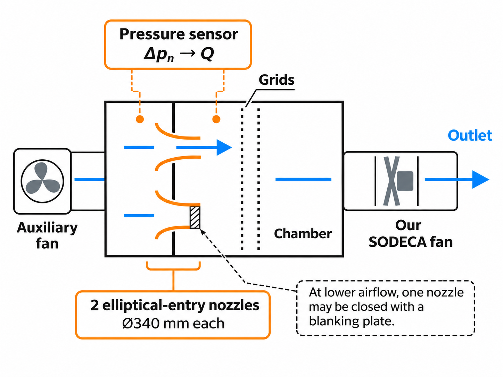
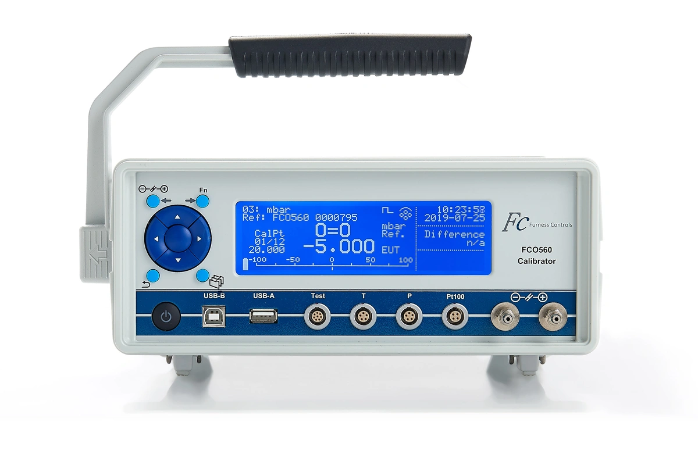
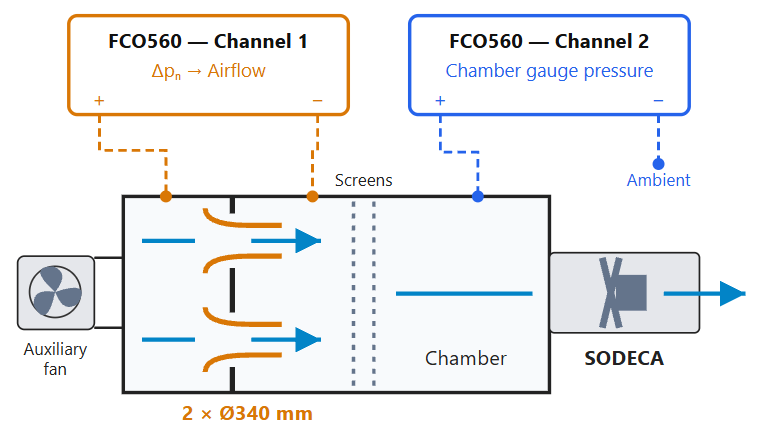
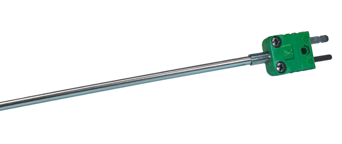
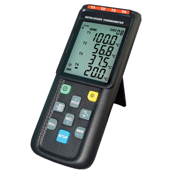
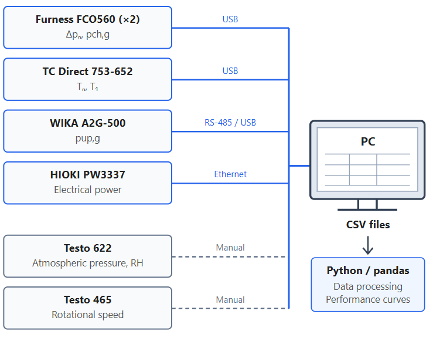
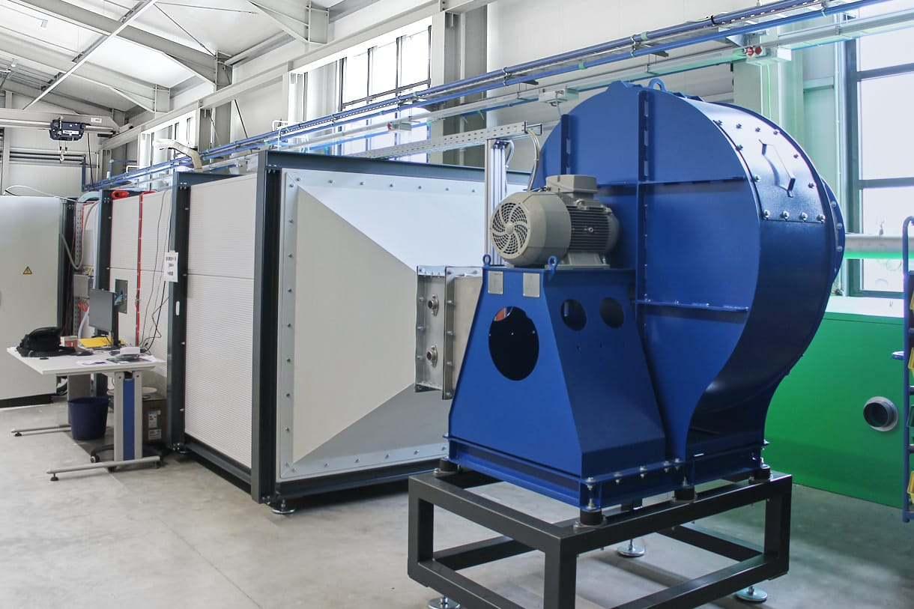
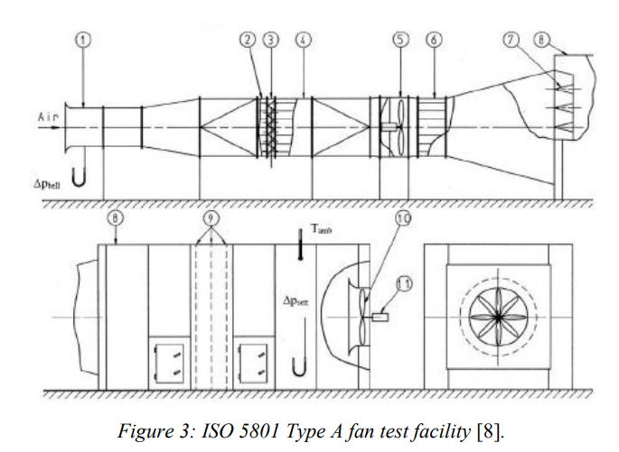
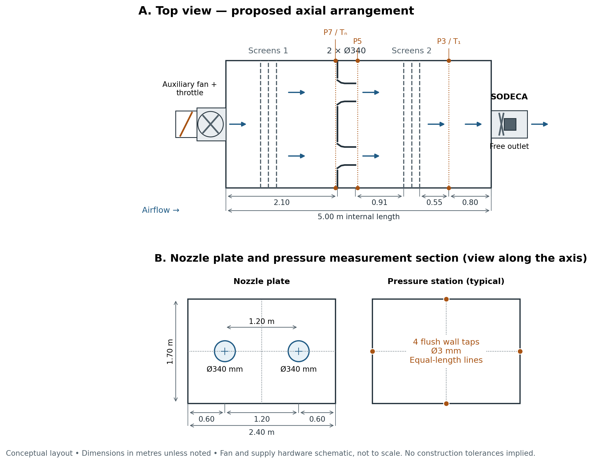

# Theoretical design of an axial fan for tunnel ventilation (SODECA THT/IMP-LS-UNI-50-2/4T-6-F400)

## 1.- Dimensions

The reference machine is a unidirectional axial jet fan used for tunnel and car park ventilation. The nominal commercial impeller diameter is 500 mm. Theoretical design calculations use the **dimensions measured in the group's CAD assembly**, rather than replacing those dimensions with the nominal catalogue designation.

### 1.1.- Commercial assembly dimensions

The manufacturer provides the following overall dimensions for the THT/IMP-LS-50 model:

*Figure 1. Dimensional drawing of the commercial SODECA fan. Source: SODECA, THT/IMP technical catalogue, page 5. **[TO VERIFY]** Confirm the drawing and model variant match the selected commercial reference.*

| Dimension | Value (mm) |
|:--|--:|
| A | 546 |
| B | 549 |
| C | 742 |
| E — Overall length | 1445 |
| L — Casing length | 1200 |
| X | 560 |
| X1 | 255 |
| Z | 778 |
| Z1 | 808 |

### 1.2.- CAD rotor dimensions and design section

The following geometrical information was provided from CAD measurements:

| Parameter | Symbol | Value |
|:--|:--:|--:|
| Rotor outer diameter | $D_t$ | 494 mm |
| Hub outer diameter at the rotor | $D_h$ | 130.5 mm |
| Diameter stated for outlet section | $D_{out}$ | 514 mm |
| Number of rotor blades | $Z$ | 6 |
| Rotor tip radius | $r_t=D_t/2$ | 247.00 mm |
| Hub radius | $r_h=D_h/2$ | 65.25 mm |
| Blade radial span | $h=r_t-r_h$ | 181.75 mm |
| Arithmetic mean radius | $r_m=(r_t+r_h)/2$ | 156.125 mm |
| Root-mean-square radius | $r_{m,RMS}=\sqrt{(r_t^2+r_h^2)/2}$ | 180.65 mm |

**Assumption 1:** The rotor and hub are represented as concentric circular sections, and local flow blockage by blade thickness is neglected when calculating the preliminary annular passage area.

$$
A=\frac{\pi}{4}(D_t^2-D_h^2)
=\frac{\pi}{4}(0.494^2-0.1305^2)
=\boxed{0.178290\;\mathrm{m^2}}.
$$

The geometric circular area associated with the stated 514 mm outlet diameter is:

$$
A_{out,geom}=\frac{\pi}{4}(0.514)^2
=\boxed{0.20750\;\mathrm{m^2}}.
$$

## 2.- Performance and operating requirements

The commercial reference is the SODECA THT/IMP-LS-UNI-50-2/4T-6-F400, an axial jet fan that supplies momentum to the surrounding air to promote longitudinal ventilation.

The performance data about the fan presented:

| Parameter | Value |
|:--|--:|
| Rotational speed (rpm) | **1445** |
| Volumetric flow rate (m³/h) | **9770** |
| Outlet air velocity (m/s) | **13.09** |
| Thrust (N) | **40.55** |

*Table 1. Previously recorded data attributed to SODECA QuickFan.*

From the parameters listed above it's possible to calculate the flow rate and the pressure of the model. 

$$
Q=\frac{9770}{3600}=\boxed{2.713889\;\mathrm{m^3/s}},\qquad
N=1445\;\mathrm{rpm}.
$$

**Assumption 3:** The reference air properties are $\rho=1.20\;\mathrm{kg/m^3}$ and $\mu=1.81\times10^{-5}\;\mathrm{Pa\,s}$.

The dynamic pressure corresponding to the **nominal outlet jet velocity** is:

$$
p_{d,jet}=\frac12\rho v_{jet}^2
=\frac12(1.20)(13.1)^2
=\boxed{102.966\;\mathrm{Pa}}.
$$

**Assumption 4 (preliminary pressure model):** Only for the purpose of calculating an initial D1/D2 design point, **$\Delta p_{0,est}=p_{d,jet}=102.966\;\mathrm{Pa}$** is adopted as a provisional idealized rotor total-pressure rise. 

As a consistency check, the geometric circular outlet area gives:

$$
\frac{Q}{A_{out,geom}}
=\frac{2.713889}{0.20750}
=13.079\;\mathrm{m/s}\approx13.1\;\mathrm{m/s}.
$$

This agreement supports the **geometric area used to report nominal jet velocity**.

Figure 2 illustrates this general concept. It is included as a theoretical reference and does not represent the performance of the selected SODECA fan.

*Figure 2. Generic fan characteristic curves; these are not measured curves of the selected SODECA fan.*

## 3.- Preliminary power estimate

The estimated jet power is:

$$
P_{jet}=Q\,p_{d,jet}
=2.713889(102.966)
=\boxed{279.44\;\mathrm{W}}.
$$

**Assumption 5:** The preliminary global jet-power-to-electrical-input efficiency is $\eta_{jet,overall}=0.50$, solely for an illustrative estimate; this is **not** a measured efficiency or a value confirmed by the manufacturer.

$$
P_{electrical,est}=\frac{P_{jet}}{\eta_{jet,overall}}
=\frac{279.44}{0.50}
=\boxed{558.88\;\mathrm{W}\approx0.56\;\mathrm{kW}}.
$$

SODECA stated a low-speed installed motor rating of 1.30 kW. The estimated 0.56 kW must not be presented as a verified measured consumption.

Because provisional $\Delta p_{0,est}=p_{d,jet}$, the idealized hydraulic power $Q\Delta p_{0,est}$ is numerically also 279.44 W. This numerical equality is a consequence of **Assumption 3**, not an independently measured hydraulic performance result.

## 4.- Applications

According to the manufacturer, THT/IMP-type axial jet fans are intended to generate high-velocity jets for ventilation and, for appropriately certified variants, smoke-control applications in enclosed spaces such as car parks. This project uses the commercial SODECA fan as a reference for **tunnel longitudinal ventilation**, where the jet transfers momentum to the surrounding air and assists in pollutant dilution and air movement. The model designation used in the project contains **F400**.

Reference: [SODECA official website](https://www.sodeca.com). 

## 5.- Examples of other axial jet fans for tunnel ventilation

These products were selected by the group as commercial comparisons based principally on reported dynamic pressure. Their stated pressure values must not automatically be treated as rotor total-pressure rise.

| Manufacturer and model | Rotational speed (rpm) | Estimated dynamic pressure (Pa) | Diameter | Airflow (m³/h) |
|:--|--:|--:|--:|--:|
| Soler & Palau — TJHT/2/4-500-C | 1440 | 94 | 500 mm | 8800 |
| Zitrón — JZp 4/H-1,5/0,37-2/4 RE F400 | 2845 | 220 | 400 mm | 8700 |
| Novovent — JET WINDER 4-560T-4 0.55 kW | 1500 | 78 | 490 mm | 10087 |

References: 

Novovent: https://fnpgroup.es/

Zitrón: https://zitron.com/?lang=es

Novovent: https://www.solerpalau.com/es-es/

## 6.- Dimensionless parameters and position in the Cordier diagram

This section follows the definitions presented in the D1 notebook and in Dixon and Hall (Chapter 2). The reference length is the **measured rotor diameter $D=D_t=0.494$ m** and the operating point is **1445 rpm only**.

$$
\omega=\frac{2\pi N}{60}
=\frac{2\pi(1445)}{60}
=\boxed{151.320\;\mathrm{rad/s}}.
$$

The mean axial speed through the rotor annulus is:

$$
c_x=\frac{Q}{A}
=\frac{2.713889}{0.178290}
=\boxed{15.222\;\mathrm{m/s}}.
$$

**Assumption 6:** Steady, incompressible flow with uniform mean axial velocity across the rotor annulus; the mean axial speed is assumed unchanged between rotor inlet and outlet ($c_{x1}=c_{x2}=c_x$). This is a one-dimensional simplification, not a measured profile.

### 6.1.- Flow coefficient

$$
\phi=\frac{Q}{\omega D^3}
=\frac{2.713889}{151.320(0.494)^3}
=\boxed{0.14877}.
$$

### 6.2.- Pressure coefficient

$$
\psi=\frac{\Delta p_{0,est}}{\rho\omega^2D^2}
=\frac{102.966}{1.20(151.320)^2(0.494)^2}
=\boxed{0.01536}.
$$

### 6.3.- Hydraulic power coefficient

$$
\hat P=\frac{Q\Delta p_{0,est}}{\rho\omega^3D^5}
=\phi\psi
=\boxed{0.002284}.
$$

### 6.4.- Reynolds number

The Reynolds number here is defined using the rotor diameter and the annular mean axial speed:

$$
Re_D=\frac{\rho c_xD}{\mu}
=\frac{1.20(15.222)(0.494)}{1.81\times10^{-5}}
=\boxed{4.99\times10^5}.
$$

The Reynolds number based on the **blade chord and inlet relative speed** is calculated separately in Section 9.

### 6.5.- Specific speed and specific diameter

$$
\Omega_s=\frac{\omega\sqrt Q}{(\Delta p_{0,est}/\rho)^{3/4}}
=\boxed{8.842},
$$

$$
D_s=\frac{D(\Delta p_{0,est}/\rho)^{1/4}}{\sqrt Q}
=\boxed{0.9127}.
$$

| Dimensionless parameter | Symbol | Calculated value at 1445 rpm |
|:--|:--:|--:|
| Flow coefficient | $\phi$ | 0.14877 |
| Pressure coefficient | $\psi$ | 0.01536 |
| Hydraulic power coefficient | $\hat P$ | 0.002284 |
| Diameter-based Reynolds number | $Re_D$ | $4.99\times10^5$ |
| Specific speed | $\Omega_s$ | 8.842 |
| Specific diameter | $D_s$ | 0.9127 |

### 6.6.- Position in the Cordier diagram

Figure 3 is the **Dixon-and-Hall-style Cordier diagram**. The horizontal axis is the logarithmic specific diameter $D_s$ and the vertical axis is the logarithmic specific speed $\Omega_s$.

$$
\boxed{(D_s,\Omega_s)_{1445\,rpm}=(0.9127,\,8.842)}.
$$

*Figure 3. Cordier diagram based on Dixon and Hall. The **orange low-speed marker** indicates the 1445 rpm condition in the characteristic axial-flow region.

## 7.- Geometry of the axial fan components

The commercial reference and preliminary theoretical fan have the following principal components. **The blade chord, profile and stagger are design choices, not CAD measurements of a finalized blade.**

| Component | Description / function |
|:--|:--|
| Rotor blades | Six blades impart tangential momentum to the airflow | $Z=6$; $D_t=494$ mm; preliminary mean-radius chord selected in Section 9 |
| Hub | Connects blade roots to rotating assembly | $D_h=130.5$ mm |
| Shaft / rotor coupling | Transmits torque | Attached to the hub by elastic coupling |
| Casing / duct | Contains flow and supports assembly | Existing commercial dimensions in Section 1 |
| Motor | Drives the rotor | Low-speed operation at 1445 rpm |
| Motor mounting supports | Secure motor inside the structure | Little structure under the motor attached inside the rube of the fan occupying the less space possible to not obstruct the air flow |
| Outlet | Delivers jet to surrounding air | Stated diameter 514 mm |
| Protective grille, deflector and silencers | Safety/noise/jet management where applicable | Present in commercial product description, located in the entrance of the fan |

## 8.- Materials and characteristics. Justification

Material specifications are listed below according to manufacturing facilities

| Component | Material | manufacturing justification |
|:--|:--|:--|
| Rotor blades | Aluminum | Low | Reduces rotor mass and rotational inertia. Suitable for manufacturing complex aerodynamic blade geometries by casting. |
| Hub | Aluminum  | Reduces rotating mass while providing a mechanically resistant connection to the shaft. |
| Shaft / coupling | Steel | Suitable for transmitting motor torque and resisting torsional and fatigue loads. |
| Casing | S235JR GALVA   | Economical material suitable for sheet-metal forming, welding and structural support. |
| Motor supports | S235JR GALVA | Suitable for welded or bolted supports connecting the motor assembly to the casing. |
| Protective elements (if present) | S235JR GALVA | Provides protection against contact with rotating components and foreign objects. It's easy to produce |
| Motor casing | Aluminum | Most common material for low power motors |

## 9.- Mean-line analysis and preliminary blade design

The flow model is steady and two-dimensional. The final airfoil selection and radial design will be done in Release 2.

**Assumption 7:** The inlet has no pre-swirl: $c_{\theta1}=0$. This is a boundary-condition assumption; the absence of upstream guide vanes does not by itself prove that the real inflow has zero swirl.

**Assumption 8:** The provisional rotor pressure rise follows the Euler energy-transfer equation is applied ideally, with no losses in the velocity-triangle calculation. This **does not imply a real overall fan efficiency of 100%**.

### 9.1.- Velocity triangles at the mean radius

$$
U_m=\omega r_m=151.320(0.156125)
=\boxed{23.625\;\mathrm{m/s}}.
$$

$$
c_{x1}=c_{x2}=c_x=15.222\;\mathrm{m/s},\qquad c_{\theta1}=0.
$$

For the idealized rotor:

$$
\Delta p_{0,est}=\rho U_m(c_{\theta2}-c_{\theta1}),
$$

$$
c_{\theta2}=\frac{102.966}{1.20(23.625)}
=\boxed{3.632\;\mathrm{m/s}}.
$$

The inlet and outlet relative speeds are:

$$
w_1=\sqrt{c_x^2+U_m^2}
=\boxed{28.104\;\mathrm{m/s}},
$$

$$
w_2=\sqrt{c_x^2+(U_m-c_{\theta2})^2}
=\boxed{25.128\;\mathrm{m/s}}.
$$

Using positive relative-flow angles measured from the axial direction toward the direction opposing blade motion:

$$
\beta_1=\arctan\left(\frac{U_m}{c_x}\right)
=\boxed{57.206^\circ},
$$

$$
\beta_2=\arctan\left(\frac{U_m-c_{\theta2}}{c_x}\right)
=\boxed{52.716^\circ}.
$$

$$
\beta_m=\arctan\left(\frac{\tan\beta_1+\tan\beta_2}{2}\right)
=\boxed{55.086^\circ}.
$$

| Velocity-triangle quantity | Inlet (1) | Outlet (2) |
|:--|--:|--:|
| Axial absolute velocity $c_x$ (m/s) | 15.222 | 15.222 |
| Absolute tangential velocity $c_\theta$ (m/s) | 0 | 3.632 |
| Relative velocity magnitude $w$ (m/s) | 28.104 | 25.128 |
| Relative flow angle $\beta$ (deg) | 57.206 | 52.716 |

### 9.2.- Blade count, pitch and diffusion criterion

The number of blades is fixed at $Z=6$. At the arithmetic mean radius:

$$
s=\frac{2\pi r_m}{Z}
=\frac{2\pi(0.156125)}{6}
=\boxed{0.163494\;\mathrm{m}=163.49\;\mathrm{mm}}.
$$

**Assumption 9:** For preliminary dimensioning, the allowable Lieblein diffusion factor is taken as $DF_{max}=0.45$. The D2 example also discusses values around 0.5. The selected design is checked against this conservative 0.45 limit.

$$
DF=1-\frac{w_2}{w_1}
+\frac{c_{\theta2}-c_{\theta1}}{2w_1}\frac{s}{l}.
$$

Setting $DF=DF_{max}$ and solving for the maximum pitch-to-chord ratio gives:

$$
\left(\frac{s}{l}\right)_{max}
=\frac{2w_1}{c_{\theta2}-c_{\theta1}}
\left(DF_{max}-1+\frac{w_2}{w_1}\right)
=\boxed{5.325}.
$$

$$
l_{min,DF}=\frac{s}{(s/l)_{max}}
=\frac{163.49}{5.325}
=\boxed{30.70\;\mathrm{mm}}.
$$

This lower bound prevents excessive diffusion in the simplified mean-radius model; it is **not** the final chord selection.

### 9.3.- Chord selection for the target lift coefficient

**Assumption 10:** A preliminary two-dimensional section drag coefficient $C_D=0.02$ is adopted. Its validity for the actual airfoil at the operating Reynolds number remains to be established.

**Design requirement:**  $C_L\approx0.75$ to remain below its preferred approximate upper range of 0.8–0.9.

The mean-line cascade relation from Dixon and Hall, Equation (3.26a), is:

$$
C_L=2\frac{s}{l}\cos\beta_m
(\tan\beta_1-\tan\beta_2)
-C_D\tan\beta_m.
$$

The previously considered chord of $l=47$ mm would give:

$$
\left(\frac{s}{l}\right)_{47mm}
=\frac{163.494}{47}=3.479,
\qquad \boxed{C_{L,47mm}=0.921}.
$$

Solving the lift equation for $C_{L,target}=0.75$:

$$
l=\frac{2s\cos\beta_m(\tan\beta_1-\tan\beta_2)}
{C_{L,target}+C_D\tan\beta_m}
=\boxed{57.35\;\mathrm{mm}}.
$$

A rounded **preliminary design chord $l=57.5$ mm** is adopted. This is a proposed dimension for subsequent CAD work, **not** a measured chord or a CFD-validated result.

$$
\frac{s}{l}=\frac{163.494}{57.5}=\boxed{2.843},
\qquad
\sigma=\frac{l}{s}=\boxed{0.352}.
$$

$$
\boxed{C_L=0.748},\qquad
\boxed{DF=0.290}.
$$

The corresponding blade-section Reynolds number based on the inlet relative velocity is:

$$
Re_l=\frac{\rho w_1l}{\mu}
=\frac{1.20(28.104)(0.0575)}{1.81\times10^{-5}}
=\boxed{1.07\times10^5}.
$$

| Quantity | Proposed 57.5 mm chord |
|:--|--:|
| Blade count $Z$ | 6 |
| Pitch $s$ (mm) | 163.49 |
| Chord $l$ (mm) | **57.50** |
| Pitch-to-chord $s/l$ | **2.843** |
| Solidity $l/s$ | **0.352** |
| Required $C_L$ | **0.748** |
| Diffusion factor $DF$ | **0.290** |

The rounded chord satisfies the selected mean-radius $C_L$ target and the diffusion-factor criterion within the adopted theoretical assumptions.

### 9.4.- Preliminary blade orientation and aerodynamic limitations

The calculated **flow angles** are $\beta_1=57.206^\circ$ and $\beta_2=52.716^\circ$. They are derived from the idealized velocity triangles and do **not** define a unique airfoil shape.

**Assumption 11:** It has been considered $\xi=53^\circ$ as a **preliminary chord stagger**, in analogy with the C3 cascade classroom example. The corresponding *chord-referenced* incoming angle is:

$$
\alpha_{chord}=\beta_1-\xi
=57.206^\circ-53^\circ
=\boxed{4.206^\circ}.
$$

## 11.- Computational fluid dynamics (CFD)

The CFD work presented in this release corresponds to a **preliminary two-dimensional cascade simulation** based on the methodology developed in the C3 course notebook. Its purpose at this stage is to define and test the CAD preparation, mesh strategy and boundary conditions required for the numerical analysis.

**Assumption 12 (preliminary CFD iteration):** The CFD model was generated before the rotor dimensions were updated using the measurements obtained from the group's CAD assembly. Consequently, the simulation corresponds to an earlier mean-line design iteration and must not be interpreted as a numerical validation of the current geometry defined in Section 9.

The main differences are summarised below:

| Parameter | Preliminary CFD case | Current design, Section 9 |
|:--|--:|--:|
| Mean radius $r_m$ (mm) | 187.50 | 156.125 |
| Blade pitch $s$ (mm) | 196.35 | 163.49 |
| Blade chord $l$ (mm) | 47.0 | 57.5 |
| Blade count $Z$ | 6 | 6 |
| Rotational speed $N$ (rpm) | 1445 | 1445 |

The CFD geometry and operating conditions will therefore be updated in Release 2 once the blade geometry and radial design have been established.

## 11.1 CAD description

The preliminary numerical model represents a single blade passage of the rotor at the mean radius. Periodic boundaries are used in the pitchwise direction so that only one blade section has to be simulated.

The airfoil used in this preliminary model is a **NACA 65(1)-212** profile. This profile is adopted as a numerical reference because it is the profile used in the C3 cascade exercise. It is **not assumed to be the actual SODECA blade profile or the final profile of the designed rotor**.

The geometry was obtained by modifying the original C3 airfoil model in SimScale. The original profile was first scaled to a chord of 60 mm and rotated to the $50^\circ$ stagger angle used in the classroom example. For the project simulation, an additional scale factor was applied:

$$
\frac{47}{60}=0.7833,
$$

resulting in a preliminary chord:

$$
l=\boxed{47\ \mathrm{mm}}.
$$

An additional rotation of $3^\circ$ was applied around the $z$ axis, resulting in a total preliminary stagger angle:

$$
\xi=50^\circ+3^\circ=\boxed{53^\circ}.
$$

For this iteration, the blade pitch was:

$$
s=\boxed{196.35\ \mathrm{mm}},
$$

and therefore:

$$
\frac{s}{l}=\frac{196.35}{47}
=\boxed{4.18}.
$$

The pitchwise limits of the computational domain were consequently placed at:

$$
y=\pm\frac{s}{2}
=\boxed{\pm0.098175\ \mathrm{m}}.
$$

The $x$ direction represents the axial direction of the fan and the $y$ direction represents the tangential direction of the cascade. The domain is treated as a quasi-two-dimensional blade passage following the approach of the C3 exercise.

The resulting CAD therefore represents a simplified mean-radius cascade and does not include the hub, casing, blade radial variation, tip clearance or the complete three-dimensional rotor.

*Figure 4. Preliminary NACA 65(1)-212 airfoil geometry used in the two-dimensional cascade model in SimScale.*

## 11.2 Mesh description

A **Hex-dominant parametric mesh** was used following the C3 numerical methodology.

The background computational domain was defined by the following limits:

| Coordinate | Minimum (m) | Maximum (m) |
|:--|--:|--:|
| $x$ | -0.300 | 0.900 |
| $y$ | -0.098175 | 0.098175 |
| $z$ | 0 | 0.060 |

The main background mesh discretisation was:

$$
\boxed{100\times10\times1}.
$$

Only one cell is used in the $z$ direction because the objective of this simulation is to approximate the flow through a two-dimensional cascade section.

A local refinement region was introduced around the airfoil and its near wake. The refinement box extends from:

$$
(-0.05,-0.098175,0)
$$

to:

$$
(0.15,0.098175,0.06)\;\mathrm{m}.
$$

A **refinement level of 2** was assigned to this region.

A boundary-layer mesh was also applied to the airfoil surface. The settings used were:

| Boundary-layer parameter | Value |
|:--|--:|
| Number of layers | 2 |
| Expansion ratio | 1.2 |
| Final layer thickness | 0.5 |
| Minimum thickness | 0.01 |

These settings follow the preliminary meshing strategy introduced in C3. The mesh is refined close to the blade and in the wake, where the largest velocity gradients are expected.

No formal grid-convergence or GCI analysis is performed in this preliminary Release 1 model. According to the project structure, the detailed mesh verification and GCI assessment will be addressed in Release 2.

*Figure 5. Computational mesh of the two-dimensional cascade domain, showing the local refinement region around the airfoil.*

## 11.3 Boundary conditions

Air was assigned as the working fluid and the flow was modelled as incompressible.

The inlet boundary condition corresponds to the velocity triangle used in the preliminary CFD iteration. The imposed relative velocity components were:

$$
\mathbf{w}_1=
(18.429,\ 28.373,\ 0)
\;\mathrm{m/s}.
$$

Therefore, the relative inlet flow angle was:

$$
\beta_1=
\tan^{-1}\left(
\frac{28.373}{18.429}
\right)
=\boxed{56.995^\circ}.
$$

Considering the preliminary stagger angle $\xi=53^\circ$, the corresponding chord-referenced incidence in this numerical case is:

$$
i_{CFD}=\beta_1-\xi
=56.995^\circ-53^\circ
=\boxed{3.995^\circ\approx4^\circ}.
$$

This incidence corresponds specifically to the **preliminary CFD case** and must not be interpreted as the definitive design incidence of the final blade profile.

The boundary conditions applied in SimScale were:

| Boundary | Type | Condition |
|:--|:--|:--|
| Minimum $x$ | Velocity inlet | $\mathbf{w}_1=(18.429,\ 28.373,\ 0)$ m/s |
| Maximum $x$ | Pressure outlet | Static pressure $p=0$ Pa |
| Minimum and maximum $y$ | Periodic | Repetition of the neighbouring blade passages |
| Airfoil surface | Wall | No-slip wall with turbulence wall function |
| Minimum and maximum $z$ | Symmetry | Quasi-two-dimensional approximation |

The periodic boundaries reproduce an infinite cascade with the specified blade pitch, while the symmetry conditions suppress the intended spanwise variation of the preliminary two-dimensional model.

A force-and-moment result control was applied to the same airfoil wall surface used in the wall boundary condition. This allows the aerodynamic forces acting on the blade section to be monitored during the calculation.

The configuration presented here documents the numerical methodology used in Release 1. Since the theoretical design was subsequently updated using the measured CAD rotor dimensions, the pitch, chord and inlet velocity components of this CFD case will be revised before using CFD results for the definitive rotor assessment.

## 12.- Experimentation: measurement of magnitudes and data acquisition (E1)

The objective of the experimental study is to characterize the aerodynamic performance of the axial fan and establish a methodology for comparison with the theoretical design and CFD results.

The selected test specimen is the complete commercial SODECA **THT/IMP-C-UNI-50-2/4T-6**, corresponding to the STEP model selected by the group. The proposed experimental tests will be carried out at the low-speed setting of **1,445 rpm**.

The reference parameters adopted from Sections 1–3 are:

| Parameter | Symbol | Reference value |
|:--|:--:|--:|
| Rotational speed | $n$ | 1,445 rpm |
| Reference airflow | $Q$ | 9,770 m³/h (2.714 m³/s) |
| Nominal impeller diameter | $D_{nom}$ | 500 mm |
| Rotor diameter | $D_t$ | 494 mm |
| Hub diameter | $D_h$ | 130.5 mm |
| Geometric outlet diameter | $D_{out}$ | 514 mm |
| Number of blades | $Z$ | 6 |
| Reference air density | $\rho$ | 1.20 kg/m³ |
| Nominal outlet air velocity | $v_{jet}$ | 13.09 m/s |
| Estimated jet dynamic pressure | $p_{d,jet}$ | 102.97 Pa |
| Nominal motor rating | $P_{nom}$ | 1.30 kW |
| Estimated electrical input power | $P_{el,est}$ | 558.88 W |

These parameters are used as preliminary inputs for the selection of the measuring instruments and the sizing of the test bench.

The commercial test specimen is distinct from the theoretical rotor described in Design. Furthermore, the preliminary CFD model described in Section 11 corresponds to an earlier design iteration. A direct comparison between experimental, theoretical and numerical results will therefore require consistent geometries, operating conditions and pressure definitions.

The following magnitudes are considered relevant for the experimental characterization:

| Quantity | Proposed measurement or calculation | Purpose |
|:--|:--|:--|
| Air volume flow rate, $Q$ (m³/s) | Calibrated nozzle bank and differential-pressure sensor. | Determine the operating point. |
| Fan static and total pressures, $p_{fs}$ and $p_f$ (Pa) | Chamber pressure relative to ambient and calculation according to the test configuration. | Obtain pressure–flow characteristic curves. |
| Rotational speed, $n$ (rpm) | Optical tachometer. | Verify rotational speed and operating stability. |
| Air temperature, $T$ (°C) | Thermocouple and data logger. | Calculate air density. |
| Atmospheric pressure, $p_a$ (Pa) | Digital barometer. | Calculate air density. |
| Relative humidity, $RH$ (%) | Digital hygrometer. | Improve air density estimation. |
| Electrical active input power, $P_{\mathrm{el}}$ (W) | Three-phase power analyser connected to the test fan supply, excluding the auxiliary fan. | Determine actual electrical consumption. |
| Shaft torque, $M$ (N·m), if accessible | Torque sensor, provided that its installation does not modify the test configuration. | Determine mechanical shaft power. |

From these measurements, the air power can be estimated at low pressure rise:

$$
P_{\mathrm{air}}\approx Qp_f
$$

The overall electrical-input efficiency can then be calculated as:

$$
\eta_{\mathrm{el}}=\frac{P_{\mathrm{air}}}{P_{\mathrm{el}}}
$$

If shaft torque measurements are available, the mechanical shaft power can also be calculated:

$$
P_{\mathrm{shaft}}=\frac{2\pi nM}{60}
$$

The corresponding fan efficiency based on shaft power is:

$$
\eta_{\mathrm{fan}}=\frac{P_{\mathrm{air}}}{P_{\mathrm{shaft}}}
$$

The estimated jet dynamic pressure of approximately 103 Pa must not be interpreted as a measured fan total-pressure rise. Similarly, the nominal motor rating of 1.30 kW and the estimated electrical input of 558.88 W do not represent measured electrical consumption.

According to the group's CAD measurements, the STEP cross-section indicates an internal diameter of 514 mm at both ends.

The intended airflow direction through the commercial fan is shown in Figure X. The proposed test chamber will be connected to the upstream end of the fan. The mounting plate, sealing system and structural supports will be defined in Section 14.2.

*Figure X. Cross-sectional view of the SODECA axial jet fan, indicating the intended airflow direction.

### 12.1.- Flow measurement and preliminary nozzle sizing

The reference airflow of the selected SODECA THT/IMP-C-UNI-50-2/4T-6 axial fan is **9,770 m³/h at 1,445 rpm**, as described in Section 2.

Considering the relatively high airflow and low pressure levels expected for this fan, different differential-pressure flow measurement devices are evaluated.

| Flow measurement device | Characteristics | Suitability for the project |
|:--|:--|:--|
| ISA 1932 nozzle | Standard nozzle installed inside a duct. | Used in the E1 course example. Its suitability depends on the duct dimensions and available pressure budget. |
| Long-radius nozzle | Nozzle with a progressive inlet contraction. | Alternative for a duct-based test bench, requiring appropriate sizing and installation conditions. |
| Bellmouth inlet | Rounded inlet drawing air from free space. | Alternative for a free-inlet configuration. |
| Elliptical-entry chamber nozzles | Multiple nozzles installed in parallel inside a chamber. | Selected for the proposed test bench because the open flow area can be adapted to different airflow ranges. |

*Table X. Comparison of differential-pressure flow measurement devices for the selected axial fan.*

Following the inlet-chamber configuration introduced in the E3 course notebook [8] and UNE-EN ISO 5801:2019, Annex A.4 [17], a system of **two identical elliptical-entry nozzles installed in parallel** is proposed.

The nozzles are independent components of the experimental test bench and are located upstream of the selected SODECA fan.

The airflow passes through the nozzle bank, where a differential-pressure transmitter measures the pressure difference required to calculate the airflow.

Both nozzles will remain open at high airflow rates. At lower airflow rates, one nozzle may be closed using a blanking plate to increase the differential-pressure signal.

The preliminary flow measurement arrangement is illustrated in Figure X.

*Figure X. Preliminary flow measurement arrangement showing the auxiliary fan, two parallel elliptical-entry nozzles, differential-pressure measurement, settling screens and the selected SODECA fan. Source: own elaboration. Conceptual sketch, not to scale.*

The main disadvantages of this configuration are the space required for the test chamber and the additional flow resistance. These aspects, together with the auxiliary fan requirements, will be considered in the test bench design described in Section 14.

#### 12.1.1.- Preliminary nozzle sizing

The reference airflow is converted into SI units:

$$
Q_{\mathrm{ref}}=\frac{9770}{3600}
=\boxed{2.7139\;\mathrm{m^3/s}}
$$

ANSI/AMCA 210-25 is used as a complementary design reference [16]. Section 5.3.2 establishes a minimum mean nozzle discharge velocity of 14 m/s at the fan free-delivery airflow.

Using the catalogue airflow as a preliminary estimate of the free-delivery airflow, the maximum throat diameter for two identical nozzles is:

$$
d_{n,\max}=
\sqrt{\frac{4Q_{\mathrm{ref}}}
{N_{\mathrm{open}}\pi v_{\min}}}
$$

Substituting the reference values:

$$
d_{n,\max}=
\sqrt{\frac{4(2.7139)}
{2\pi(14)}}
=\boxed{0.3513\;\mathrm{m}}
$$

The initially considered diameter of 400 mm would result in a mean nozzle velocity of approximately 10.80 m/s, below the adopted complementary design criterion.

Therefore, a preliminary throat diameter of **340 mm** is selected.

| Parameter | Symbol | Value |
|:--|:--:|--:|
| Reference airflow | $Q_{\mathrm{ref}}$ | 2.7139 m³/s |
| Number of installed nozzles | $N$ | 2 |
| Nozzle throat diameter | $d_n$ | 340 mm |
| Reference air density | $\rho$ | 1.20 kg/m³ |
| Dynamic viscosity | $\mu$ | $1.81\times10^{-5}$ Pa·s |
| Minimum reference nozzle velocity | $v_{\min}$ | 14 m/s |

*Table X. Reference parameters adopted for the preliminary nozzle sizing.*

The air density and dynamic viscosity are consistent with the reference air properties adopted in Section 2.

The throat area of a single nozzle is:

$$
A_{n,1}=\frac{\pi d_n^2}{4}
=\frac{\pi(0.340)^2}{4}
=\boxed{0.09079\;\mathrm{m^2}}
$$

The total open throat area is:

$$
A_n=N_{\mathrm{open}}\frac{\pi d_n^2}{4}
$$

For two open nozzles:

$$
A_n=2(0.09079)
=\boxed{0.18158\;\mathrm{m^2}}
$$

The mean nozzle velocity at the reference airflow is:

$$
v_n=\frac{Q_{\mathrm{ref}}}{A_n}
=\frac{2.7139}{0.18158}
=\boxed{14.95\;\mathrm{m/s}}
$$

The selected diameter satisfies the adopted preliminary velocity criterion:

$$
14.95>14.00\;\mathrm{m/s}
$$

This condition must be confirmed using the actual free-delivery airflow during commissioning.

#### 12.1.2.- Nozzle geometry and material selection

The proposed nozzles are based on the geometry described in UNE-EN ISO 5801:2019, Annex A.4.2 and Figure A.3 [17].

An axisymmetric elliptical inlet followed by a cylindrical throat is selected.

The throat length is:

$$
L=0.6d_n
=0.6(340)
=\boxed{204\;\mathrm{mm}}
$$

The proposed geometrical specifications are summarized below.

| Parameter | Design criterion | Proposed specification |
|:--|:--:|:--|
| Number of nozzles | Selected configuration | 2 |
| Nominal throat diameter | $d_n$ | 340 mm |
| Inlet profile | ISO 5801, Figure A.3 | Elliptical |
| Throat length | $L=0.6d_n$ | 204 mm |
| Throat length tolerance | $\pm0.005d_n$ | ±1.70 mm |
| Diameter measurement accuracy | $0.001d_n$ | 0.34 mm |
| Diameter readings relative to their mean | $\pm0.002d_n$ | ±0.68 mm |
| Maximum surface waviness | $0.001d_n$ | 0.34 mm |
| Outlet edge | Geometry requirement | Square, sharp and free from burrs |
| Proposed material | Preliminary selection | Machined aluminium |

*Table X. Proposed nozzle geometry, dimensional requirements and material selection.*

The main nozzle dimensions are illustrated in Figure X.

*Figure X. Conceptual longitudinal cross-section of the proposed elliptical-entry nozzle, indicating the throat diameter and length. Source: own elaboration. Not a manufacturing drawing.*

Machined aluminium is proposed because of its corrosion resistance, machinability and suitability for producing a smooth internal surface.

The final manufacturing process must be selected considering dimensional accuracy, surface quality and cost.

#### 12.1.3.- Estimation of the discharge coefficient

The nozzle Reynolds number is estimated using the reference air properties adopted in Section 2 and the mean throat velocity:

$$
Re_n\approx\frac{\rho v_n d_n}{\mu}
$$

Substituting the reference values:

$$
Re_n\approx
\frac{1.20(14.9456)(0.340)}
{1.81\times10^{-5}}
=\boxed{3.37\times10^5}
$$

For the selected throat length-to-diameter ratio of 0.6, the discharge coefficient is estimated using the correlation described in ISO 5801, Annex A.4.4, and ANSI/AMCA 210-25 [16, 17]:

$$
C_d=0.9986-\frac{7.006}{\sqrt{Re_n}}
+\frac{134.6}{Re_n}
$$

Substituting the estimated Reynolds number:

$$
C_d\approx0.9986-
\frac{7.006}{\sqrt{336900}}
+\frac{134.6}{336900}
$$

$$
\boxed{C_d\approx0.98693}
$$

The estimated coefficient is close to the value of 0.985 used in the E3 course inlet-chamber example [8].

Since the discharge coefficient depends on the Reynolds number, it must be recalculated for different operating points.

The value obtained here is an engineering estimate for preliminary sizing, not an experimentally determined calibration coefficient. The complete standard calculation, including its Reynolds-number formulation and correction factors, will be applied during the definitive data reduction.

#### 12.1.4.- Estimated differential pressure

For preliminary sizing, neglecting compressibility and upstream velocity corrections, the volumetric airflow through the nozzle bank can be estimated as:

$$
Q\approx C_d A_n
\sqrt{\frac{2\Delta p_n}{\rho}}
$$

where:

- $Q$: volumetric airflow (m³/s).
- $C_d$: nozzle discharge coefficient.
- $A_n$: total open nozzle throat area (m²).
- $\Delta p_n$: nozzle differential pressure (Pa).
- $\rho$: upstream air density (kg/m³).

Rearranging the expression to estimate the differential pressure:

$$
\Delta p_n\approx
\frac{\rho}{2}
\left(\frac{Q}{C_d A_n}\right)^2
$$

At the reference airflow, with both nozzles open:

$$
\Delta p_n\approx
\frac{1.20}{2}
\left(
\frac{2.7139}{0.98693(0.18158)}
\right)^2
$$

$$
\boxed{\Delta p_n\approx137.6\;\mathrm{Pa}}
$$

Different operating conditions are considered to evaluate the flexibility of the proposed nozzle arrangement.

| Airflow (m³/h) | Open nozzles | Approximate Reynolds number | Estimated $C_d$ | Estimated differential pressure (Pa) |
|--:|--:|--:|--:|--:|
| 9,770 | 2 | 336,900 | 0.98693 | 137.6 |
| 4,885 | 2 | 168,450 | 0.98233 | 34.7 |
| 4,885 | 1 | 336,900 | 0.98693 | 137.6 |
| 9,770 | 1 | 673,800 | 0.99026 | 546.7 |

*Table X. Estimated Reynolds numbers, discharge coefficients and differential pressures for different airflow rates and nozzle configurations.*

At half the reference airflow, closing one nozzle increases the estimated differential pressure from 34.7 Pa to 137.6 Pa, provided that the same airflow is maintained.

This increases the measurement signal and reduces the relative influence of a fixed absolute pressure measurement error.

Closing one nozzle modifies the resistance of the test bench. Consequently, the operating point must be readjusted before comparing both configurations.

Operation with only one nozzle at the maximum reference airflow is not intended because the resulting differential pressure would be unnecessarily high.

The expected differential pressures will be used to select the pressure measurement instruments in Section 12.2.

The nozzle differential pressure must not be confused with the fan pressure rise or directly interpreted as the permanent pressure loss of the nozzle bank.

#### 12.1.5.- Nozzle verification and calibration requirements

According to UNE-EN ISO 5801:2019/A1:2025 [24], the multiple-nozzle installation will undergo a verification test and calibration against a traceable reference airflow measurement system.

The theoretical discharge coefficient calculated in Section 12.1.3 is used for preliminary sizing. The calibrated coefficient will be used for the final experimental data reduction.

The pressure ratio is defined as:

$$
r_d=1-\frac{\Delta p_n}{p_{\mathrm{up}}}
$$

where $p_{\mathrm{up}}$ is the absolute upstream pressure.

Assuming a preliminary upstream absolute pressure of 101,325 Pa:

$$
r_d\approx1-\frac{137.6}{101325}
=\boxed{0.99864}
$$

The estimated pressure ratio is above the specified limit:

$$
r_d>0.9
$$

At the reference operating point, the estimated nozzle Reynolds number is also above 12,000.

ISO 5801, Annex A.4.5, provides a discharge coefficient uncertainty of ±1.2% above this Reynolds number threshold [17]. This contribution will be considered in the uncertainty assessment presented in Section 13.

The actual airflow calculation will use the measured nozzle dimensions, air properties and differential pressure, together with the applicable standard corrections.

Before experimental testing, the complete nozzle profile, dimensional tolerances, surface quality, pressure measurement stations and flow-settling arrangements must be verified.

The proposed dimensions and discharge coefficients therefore constitute the preliminary design of the airflow measurement system for Release 1. No physical calibration or experimental measurements have been performed at this stage.

### 12.2.- Selection of digital differential-pressure instruments

#### 12.2.1.- Pressure measurement requirements

Two independent differential-pressure measurement channels are required for the proposed experimental test bench.

| Channel | Measured quantity | Purpose |
|:--|:--|:--|
| 1 | Nozzle differential pressure, $\Delta p_n$ | Airflow determination |
| 2 | Chamber gauge pressure, $p_{\mathrm{ch},g}$ | Fan pressure characterization |

*Table X. Pressure measurement requirements for the experimental test bench.*

According to the nozzle calculations presented in Section 12.1, the expected differential pressure at the reference airflow of 9,770 m³/h is approximately 137.6 Pa, decreasing to 34.7 Pa at half the reference airflow with both nozzles open.

Therefore, the selected instruments must provide sufficient accuracy at low differential pressures. Bidirectional measurement is also required to measure positive and negative chamber gauge pressures.

#### 12.2.2.- Instrument comparison and selection

Following the recommendations of the E1 course notebook, the WIKA and Keller catalogues were consulted. A high-accuracy laboratory instrument from Furness Controls was also considered.

| Parameter | WIKA A2G-500 [10] | Keller PD-41X [19] | Furness FCO560 [18] |
|:--|:--|:--|:--|
| Evaluated range | ±250 Pa | 0–3,000 Pa | ±2,000 Pa |
| Basic accuracy | ±1.25 Pa | ±3 Pa | 0.1% of reading + 0.03 Pa |
| Relative error at 137.6 Pa | 0.91% | 2.18% | 0.12% |
| Relative error at 34.7 Pa | 3.60% | 8.65% | 0.19% |
| Relative error at 10 Pa | 12.50% | 30.00% | 0.40% |
| Communication | RS-485 | RS-485 | USB / RS-232 |

*Table X. Comparison of differential-pressure instruments based on manufacturer specifications under reference conditions.*

ISO 5801 [17] establishes a pressure measurement uncertainty criterion of 1.4% for the airflow measurement device.

The relative basic instrument error is estimated as:

$$
e_r=\frac{e_{\mathrm{abs}}}{|\Delta p|}
\times100
$$

For the Furness FCO560, at half the reference airflow with both nozzles open:

$$
e_r=
\frac{0.001(34.7)+0.03}{34.7}
\times100
=\boxed{0.19\%}
$$

The WIKA and Keller instruments present higher relative errors at low differential pressures. Therefore, two **Furness Controls FCO560 precision digital manometers, 2 kPa version**, are selected.

*Figure X. Furness Controls FCO560 digital precision manometer. Source: Furness Controls [18].*

The main characteristics of the selected instruments are:

| Parameter | Selected specification |
|:--|:--|
| Manufacturer | Furness Controls |
| Model | FCO560 |
| Quantity | 2 units |
| Measuring range | ±2,000 Pa |
| Basic accuracy at 20 °C | 0.1% of reading + 0.03 Pa |
| Measurement medium | Air |
| Communication | USB |
| Operating temperature | 5–45 °C |

*Table X. Main technical specifications of the selected differential-pressure instruments.*

Although the Furness instrument is more specialized and potentially more expensive, its higher accuracy at low differential pressures makes it more suitable for the proposed experimental application.

For preliminary test planning, a minimum nozzle differential pressure of 10 Pa is targeted, corresponding to a basic relative instrument error of 0.40%.

The complete measurement uncertainty will be evaluated in Section 13.

#### 12.2.3.- Instrument installation

The proposed pressure measurement arrangement is illustrated in Figure X.

*Figure X. Conceptual arrangement of the two Furness Controls FCO560 differential-pressure measurement channels. Source: own elaboration. Not to scale.*

**Channel 1 — Nozzle differential pressure**

The pressure ports are connected upstream and downstream of the nozzle bank.

$$
\boxed{\Delta p_n=p_{\mathrm{up}}-p_{\mathrm{down}}}
$$

This pressure difference is used to determine the airflow according to Section 12.1.

**Channel 2 — Chamber gauge pressure**

The positive port is connected to the chamber pressure station, while the negative port is referenced to the laboratory atmosphere.

$$
\boxed{p_{\mathrm{ch},g}=p_{\mathrm{ch}}-p_a}
$$

This measurement is used to determine the fan pressure characteristics according to the test configuration described in Section 14.

Both instruments will be connected to the data acquisition computer through USB interfaces.

Before testing, the instruments will be zeroed, their calibration status will be checked and the pressure connections will be inspected for leakage.

The data acquisition procedure and uncertainty assessment are described in Sections 12.5 and 13, respectively.

### 12.3.- Air temperature measurement and data recording

Air temperature must be measured to determine the air density required for airflow and fan performance calculations.

As a first approximation, dry air density can be calculated using the ideal gas equation:

$$
\boxed{\rho=\frac{p_{\mathrm{abs}}}{RT}}
$$

where $p_{\mathrm{abs}}$ is the absolute pressure, $T$ is the absolute temperature and $R=287.05\;\mathrm{J/(kg\,K)}$ is the specific gas constant for dry air.

The actual air properties will be determined from the measured operating conditions.

#### 12.3.1.- Thermocouple and data logger selection

Following the recommendations of the E1 course notebook, the TC Direct catalogue was consulted.

Two **TC Direct 405-388 Type T thermocouples** are selected because of their suitability for measurements at moderate temperatures.

A small probe diameter is selected to minimize airflow disturbance and favour a fast thermal response.

Both thermocouples will be connected to a **TC Direct 753-652 four-channel digital data logger**, allowing temperature measurements at different positions within the test bench.

The main characteristics of the selected instruments are presented below [20, 21].

| Parameter | Thermocouple | Data logger |
|:--|:--|:--|
| Manufacturer | TC Direct | TC Direct |
| Product reference | 405-388 | 753-652 |
| Quantity | 2 | 1 |
| Sensor type | Type T (copper-constantan) | Type T compatible |
| Probe diameter | 1.5 mm | — |
| Probe length | 300 mm | — |
| Sheath material | AISI 321 stainless steel | — |
| Junction | Insulated | — |
| Input channels | — | 4 |
| Temperature resolution | — | 0.1 °C |
| Logger accuracy | — | ±(0.1% of reading + 0.7 °C) |
| Selected recording interval | — | 1 s |
| Communication | Miniature connector | USB |

*Table X. Technical specifications of the selected thermocouples and temperature data logger.*

*Figure X. TC Direct 405-388 mineral-insulated Type T thermocouple. Source: TC Direct [20].*

*Figure X. TC Direct 753-652 four-channel temperature data logger. Source: TC Direct [21].*

#### 12.3.2.- Installation and temperature recording

Two temperature measurement stations are proposed:

- $T_n$: upstream of the nozzle bank, to determine the air density required for airflow calculations.
- $T_1$: inside the fan inlet chamber, to determine the air conditions at the fan inlet.

The probes will be installed using sealed supports, with their sensing tips exposed to representative airflow and away from walls and external heat sources.

Both thermocouples will be connected to the same data logger. Temperature readings will be recorded at intervals of 1 second during a 30-second measurement window under stabilized operating conditions.

The recorded data will be transferred to the computer via USB and synchronized with the remaining experimental measurements described in Section 12.5.

The thermocouple and data logger will be calibrated as a complete measurement chain. Their calibration uncertainty and temperature measurement uncertainty will be included in Section 13.

### 12.4.- Complementary instrumentation

In addition to the airflow, differential-pressure and temperature measurements described in the previous sections, complementary instruments are required to determine the atmospheric conditions, rotational speed and electrical power consumption.

#### 12.4.1.- Instrument selection

The following instruments are selected based on the expected operating conditions of the SODECA axial fan.

| Instrument | Measured quantity | Main specifications |
|:--|:--|:--|
| Testo 622 [12] | Atmospheric pressure and relative humidity | Pressure range: 300–1,200 hPa; accuracy: ±(3 hPa + 1 digit). Relative humidity range: 0–100%; accuracy: ±(2 percentage points + 1 digit) at 25 °C and 10–90% RH. |
| WIKA A2G-500 [10] | Upstream nozzle gauge pressure | ±2,500 Pa hardware version; configured range: ±1,000 Pa; basic accuracy: ±12.5 Pa at 23 °C; Modbus RTU. |
| Testo 465 [13] | Rotational speed | Range: 1–99,999 rpm; accuracy: ±0.02% of reading; resolution: 1 rpm at the reference speed. |
| HIOKI PW3337 [14] | Three-phase active electrical power | Three measurement channels; maximum direct inputs: 1,000 V and 65 A; LAN communication. |

*Table X. Complementary instrumentation selected for the experimental test bench.*

The Testo 622 will be installed in a representative laboratory location, away from the fan discharge jet and external heat sources.

The additional WIKA A2G-500 will measure the upstream nozzle gauge pressure relative to the laboratory atmosphere. Its accuracy is sufficient for this supplementary density correction, whereas the higher-accuracy Furness FCO560 instruments are retained for the primary pressure measurements described in Section 12.2.

The optical tachometer will measure the actual rotational speed using a reflective mark installed on a rotating component, with the fan stopped during installation and a safe optical access during operation.

The HIOKI PW3337 will measure the active electrical power supplied exclusively to the SODECA fan, excluding the auxiliary fan consumption. The electrical connections will be performed by qualified personnel according to the manufacturer instructions.

#### 12.4.2.- Application to fan performance calculations

The absolute pressure upstream of the nozzle bank is calculated as:

$$
\boxed{p_{\mathrm{up,abs}}=p_a+p_{\mathrm{up},g}}
$$

Similarly, the absolute pressure inside the fan inlet chamber is:

$$
\boxed{p_{\mathrm{ch,abs}}=p_a+p_{\mathrm{ch},g}}
$$

These pressures, together with the measured temperatures and humidity, are used to determine the air density. The ambient water vapour fraction is assumed to remain constant through the inlet system, since no humidification or condensation is intended.

The measured rotational speed will be used to verify the reference operating condition of 1,445 rpm.

The overall efficiency based on electrical input power is calculated as:

$$
\boxed{
\eta_{\mathrm{el}}\approx
\frac{Qp_f}{P_{\mathrm{el}}}
}
$$

where $Q$ is the volumetric airflow, $p_f$ is the fan total pressure and $P_{\mathrm{el}}$ is the measured active electrical power.

Direct shaft torque measurement is not included in the proposed test bench because the motor is integrated into the commercial fan assembly. Therefore, the reported efficiency will correspond to the overall electrical-input efficiency rather than the shaft-based fan efficiency.

The recording and synchronization of these measurements are described in Section 12.5.

### 12.5.- Data acquisition and recording

The selected instruments will be connected to a computer to record and process the experimental measurements.

Digital communication will be used whenever available, while atmospheric conditions and rotational speed will be recorded manually.

| Instrument | Recorded quantity | Communication | Acquisition |
|:--|:--|:--|:--|
| Furness FCO560 (2 units) | $\Delta p_n$, $p_{\mathrm{ch},g}$ | USB | Automatic |
| TC Direct 753-652 | $T_n$, $T_1$ | USB | Automatic |
| WIKA A2G-500 | $p_{\mathrm{up},g}$ | Modbus RTU via RS-485/USB adapter | Automatic |
| HIOKI PW3337 | $P_{\mathrm{el}}$ | Ethernet | Automatic |
| Testo 622 | $p_a$, RH | Digital display | Manual |
| Testo 465 | $n$ | Digital display | Manual |

*Table X. Communication interfaces and data acquisition methods for the selected instruments.*

The proposed data acquisition architecture is illustrated in Figure X.

*Figure X. Proposed data acquisition architecture for the experimental test bench. Source: own elaboration.*

The HIOKI PW3337 measurements will be recorded using the manufacturer's GENNECT ONE software [22]. Temperature and pressure data will be retrieved using the corresponding instrument software or communication interfaces.

For each operating point, the following preliminary acquisition parameters are adopted:

| Parameter | Selected value |
|:--|:--:|
| Target sampling interval | 1 s |
| Target sampling frequency | 1 Hz |
| Stable recording window | 30 s |
| Target samples per automatic channel | 30 |
| Repeated measurements per operating point | 3 |

*Table X. Proposed experimental data acquisition parameters.*

The instrument clocks and computer clock will be aligned before testing. Measurements will be associated using timestamps, operating-point identifiers and repetition numbers.

The instruments will record data after the operating conditions have stabilized. Atmospheric conditions and rotational speed will be recorded during the corresponding measurement window.

The original data will be preserved and exported or converted into CSV format for subsequent processing.

The mean value of each recorded quantity will be calculated as:

$$
\boxed{
\bar{x}=\frac{1}{N}\sum_{i=1}^{N}x_i
}
$$

Measurement variability and repeatability will be evaluated in the uncertainty assessment described in Section 13.

The experimental data will be processed using Python, pandas and Matplotlib, following the methodology introduced in the E1 course notebook.

The resulting dataset will be used to obtain the pressure-flow, electrical power-flow and overall efficiency-flow characteristic curves of the selected axial fan.

## 13.- Preliminary assessment of measurement uncertainty (E2)

Following the methodology introduced in the E2 course notebook, a preliminary uncertainty assessment is performed according to UNE-ISO 5168:2006 and UNE-EN ISO 5801:2019, including its 2025 amendment [17, 24].

### 13.1.- Sources of measurement uncertainty

Two types of uncertainty are considered:

- Type A: evaluated from repeated experimental measurements.
- Type B: evaluated from instrument specifications, calibration information and dimensional measurements.

Since no experimental tests have been performed at the Release 1 stage, this assessment focuses on Type B uncertainty.

| Instrument or parameter | Specification or design requirement |
|:--|:--|
| Furness FCO560 [18] | Basic accuracy at 20 °C: ±(0.1% of reading + 0.03 Pa). |
| WIKA A2G-500 [10] | Basic accuracy: ±12.5 Pa. |
| Vaisala PTB330, Class A [23] | Total accuracy: ±0.15 hPa; long-term stability: ±0.10 hPa/year. |
| Testo 622 [12] | Relative humidity accuracy: ±(2 percentage points + 1 digit) at 25 °C, between 10% and 90% RH. |
| Testo 465 [13] | Accuracy: ±(0.02% of reading + 1 digit). |
| TC Direct Type T thermocouples [20] | Sensor uncertainty included in the complete temperature-chain calibration. |
| TC Direct 753-652 [21] | Logger accuracy: ±(0.1% of reading + 0.7 °C). |
| HIOKI PW3337 [14] | Basic active-power accuracy at 45–66 Hz, below 50% of full scale: ±(0.1% of reading + 0.05% of full scale). |
| Nozzle throat diameter | Measurement error target: ±0.15 mm. |
| Nozzle discharge coefficient | Expanded relative uncertainty target: 0.6%. |
| Temperature measurement chain | Expanded uncertainty target: 0.4 K. |
| Fan outlet diameter | Measurement error target: ±0.50 mm. |

*Table X. Instrument accuracy specifications and proposed measurement uncertainty requirements.*

The multiple-nozzle installation and the temperature measurement chains will be calibrated to achieve the proposed uncertainty targets.

### 13.2.- Representative operating point

A representative operating point below the catalogue reference airflow of 9,770 m³/h is selected.

The actual best efficiency point (BEP) cannot be identified without a validated performance curve.

| Parameter | Symbol | Assumed value |
|:--|:--:|--:|
| Volume flow rate | $Q$ | 2.40 m³/s |
| Rotational speed | $n$ | 1,445 rpm |
| Number of open nozzles | $N_{\mathrm{open}}$ | 2 |
| Nozzle throat diameter | $d_n$ | 0.340 m |
| Estimated discharge coefficient | $C_d$ | 0.98622 |
| Nozzle differential pressure | $\Delta p_n$ | 107.77 Pa |
| Chamber gauge pressure | $p_{\mathrm{ch},g}$ | −25 Pa |
| Upstream gauge pressure | $p_{\mathrm{up},g}$ | 100 Pa |
| Atmospheric pressure | $p_a$ | 101,325 Pa |
| Air temperature | $T$ | 20 °C |
| Relative humidity | RH | 50% |
| Estimated air density | $\rho$ | 1.200 kg/m³ |
| Preliminary outlet diameter | $D_2$ | 0.514 m |
| Electrical input power | $P_{\mathrm{el}}$ | 600 W |

*Table X. Representative operating conditions adopted for the preliminary uncertainty assessment.*

These values constitute an illustrative design scenario and do not represent experimental measurements.

For this preliminary calculation, uniform air density throughout the test bench is assumed.

The volume flow rate is calculated using the nozzle equation:

$$
Q\approx C_d A_n
\sqrt{\frac{2\Delta p_n}{\rho}}
$$

Using the preliminary outlet area:

$$
A_2=\frac{\pi D_2^2}{4}
=0.2075\;\mathrm{m^2}
$$

The estimated fan dynamic pressure is:

$$
p_{fd}=
\frac{\rho}{2}
\left(\frac{Q}{A_2}\right)^2
=\boxed{80.27\;\mathrm{Pa}}
$$

For the preliminary inlet-chamber and free-discharge configuration, neglecting chamber dynamic pressure and additional inlet corrections:

$$
p_f\approx p_{fd}-p_{\mathrm{ch},g}
$$

$$
p_f\approx80.27-(-25)
=\boxed{105.27\;\mathrm{Pa}}
$$

The aerodynamic power is:

$$
P_{\mathrm{air}}\approx Qp_f
=\boxed{252.65\;\mathrm{W}}
$$

The overall electrical-input efficiency is:

## 14.- Preliminary test bench and application of UNE-EN ISO 5801 (E3)

### 14.1.- Mounting category and reference setups

#### 14.1.1.- Installation category

According to UNE-EN ISO 5801:2019 [17] and the E3 course notebook [8], the following installation categories are considered:

| Category | Inlet | Outlet |
|:--:|:--|:--|
| **A (selected)** | Free | Free |
| B | Free | Ducted |
| C | Ducted | Free |
| D | Ducted | Ducted |

*Table X. Fan installation categories considered in the E3 course notebook.*

A **Category A inlet-chamber configuration** is selected for the proposed experimental test bench.

The SODECA axial fan will be mounted directly on the downstream wall of the chamber, without additional inlet or outlet ducts.

This configuration is particularly suitable for low-pressure axial fans because the large chamber cross-sectional area reduces the mean airflow velocity, allowing the inlet total pressure to be approximated from the chamber static pressure.

Following the design criterion introduced in E3:

$$
\boxed{A_3>5A_1}
$$

where:

- $A_3$: chamber cross-sectional area.
- $A_1$: fan inlet cross-sectional area.

The chamber dimensions and verification of this condition are presented in Section 14.2.

Since the selected commercial SODECA is a jet fan, ISO 13350 [15] is the specific standard for jet-fan performance testing. The proposed test bench is intended for academic aerodynamic characterization rather than certified jet thrust measurement.

#### 14.1.2.- Reference experimental test benches

Two existing experimental facilities have been investigated as references for the proposed test bench.

**EP BTB15,000 industrial fan test bench [25]**

This industrial facility uses measuring nozzles and follows AMCA 210. It covers airflow rates from 150 to 15,000 m³/h, including the reference airflow of our SODECA fan (9,770 m³/h).

*Figure X. EP BTB15,000 industrial fan test bench. Source: EP Ehrler Prüftechnik Engineering [25].*

**Stellenbosch University axial fan test facility [26]**

This facility uses a Category A configuration based on ISO 5801. It incorporates flow-conditioning devices, a settling chamber, adjustable flow louvres and an auxiliary fan to compensate for pressure losses.

*Figure X. Category A axial fan test facility at Stellenbosch University. Source: Steenkamp et al. (2022), Figure 3 [26].*

Based on these reference installations, the proposed test bench will incorporate:

- Two calibrated measuring nozzles of 340 mm diameter.
- An inlet chamber.
- Flow-conditioning screens.
- An auxiliary fan and airflow regulation system.
- The measurement instrumentation selected in Section 12.

The dimensions of the proposed test bench will be adapted to the geometry and operating conditions of the selected SODECA fan.

### 14.2.- Sketch and preliminary dimensions

#### 14.2.1.- Inlet chamber dimensions

A rectangular inlet chamber is proposed for the selected Category A configuration.

The preliminary internal dimensions are:

| Parameter | Symbol | Selected value |
|:--|:--:|--:|
| Chamber width | $b_3$ | 2.40 m |
| Chamber height | $h_3$ | 1.70 m |
| Chamber length | $L_3$ | 5.00 m |
| Fan inlet diameter reference | $D_1$ | 0.514 m |
| Reference airflow | $Q$ | 2.714 m³/s |
| Reference air density | $\rho$ | 1.20 kg/m³ |

*Table X. Preliminary internal dimensions and reference conditions of the proposed test chamber.*

According to ISO 5801, Clause 9.4 [17], the rectangular chamber aspect ratio must satisfy:

$$
\frac{2}{3}<\frac{b_3}{h_3}<\frac{3}{2}
$$

$$
\frac{2.40}{1.70}=\boxed{1.412}
$$

The preliminary fan inlet area and chamber cross-sectional area are:

$$
A_1=\frac{\pi D_1^2}{4}=0.2075\;\mathrm{m^2}
$$

$$
A_3=b_3h_3=4.08\;\mathrm{m^2}
$$

Therefore:

$$
\boxed{\frac{A_3}{A_1}=19.66>5}
$$

Both chamber transverse dimensions also exceed twice the reference fan inlet diameter.

At the reference airflow, the mean chamber velocity is:

$$
v_3=\frac{Q}{A_3}
=\boxed{0.665\;\mathrm{m/s}}
$$

The corresponding dynamic pressure is:

$$
p_{d3}=\frac{1}{2}\rho v_3^2
=\boxed{0.265\;\mathrm{Pa}}
$$

The low chamber velocity supports the preliminary approximation of inlet total pressure from the chamber static pressure.

#### 14.2.2.- Nozzle arrangement and flow conditioning

Two identical calibrated nozzles with a throat diameter of 340 mm are installed symmetrically in the chamber.

According to ISO 5801, Annex A.4.1, including its 2025 amendment [17, 24], the following geometric requirements are considered.

| Parameter | Minimum distance | Selected distance |
|:--|--:|--:|
| Nozzle centre-to-centre distance | $3d_n=1.020$ m | 1.200 m |
| Nozzle centre to lateral wall | $1.5d_n=0.510$ m | 0.600 m |
| Nozzle centre to upper and lower walls | $1.5d_n=0.510$ m | 0.850 m |

*Table X. Nozzle positioning requirements and selected dimensions.*

Both nozzles will operate simultaneously to maintain a symmetrical airflow distribution.

Two groups of flow-conditioning screens will be installed upstream and downstream of the nozzle bank. Each group initially consists of three screens with decreasing open-area ratios in the airflow direction, following the recommendations of AMCA 210 [16].

The chamber hydraulic diameter is:

$$
D_{h3}=
\frac{2b_3h_3}{b_3+h_3}
=\boxed{1.99\;\mathrm{m}}
$$

The preliminary axial distances are selected according to ISO 5801, Clause 9.4 and Figure A.2, together with the complementary recommendations of AMCA 210, Figure 15.

| Distance | Reference minimum | Selected distance |
|:--|--:|--:|
| Upstream settling means to nozzle inlet | 0.995 m | 1.150 m |
| Nozzle exit to downstream settling means | 0.850 m | 0.910 m |
| Final settling screen to pressure plane 3 | 0.398 m | 0.550 m |
| Pressure plane 3 to fan inlet | 0.597 m | 0.800 m |

*Table X. Preliminary axial distances between the main test bench components.*

The effectiveness of the settling screens will be verified during commissioning according to ISO 5801, Clause 9.3.

#### 14.2.3.- Test bench layout and instrumentation

The proposed test bench arrangement is shown in Figure X.

*Figure X. Preliminary dimensioned layout of the proposed Category A test bench, including the nozzle arrangement and pressure measurement stations. Source: own elaboration based on ISO 5801 [17, 24] and AMCA 210 [16].*

The longitudinal coordinate $x$ is measured from the upstream chamber wall.

| Component or station | Axial position |
|:--|--:|
| Upstream screen group | 0.65, 0.80 and 0.95 m |
| Nozzle inlet | 2.10 m |
| Nozzle outlet | 2.44 m |
| Downstream screen group | 3.35, 3.50 and 3.65 m |
| Chamber pressure plane 3 | 4.20 m |
| SODECA mounting plane | 5.00 m |

*Table X. Preliminary axial coordinates of the test bench components.*

Three static-pressure measurement stations are incorporated:

- Station 7: upstream of the nozzle bank.
- Station 5: downstream of the nozzle bank.
- Station 3: inside the fan inlet chamber, downstream of the settling screens.

Each station will initially incorporate four wall pressure tappings, positioned at the centre of each chamber side.

A tapping diameter of 3 mm is selected, with perpendicular, flush and burr-free openings. Equal-length pressure connections will be used to obtain representative mean static-pressure readings, following ISO 5801, Clause 12.8 [17].

The precise nozzle pressure tapping offsets will follow the selected calibrated nozzle installation geometry.

The two thermocouples will measure air temperature upstream of the nozzle bank and at the fan inlet chamber.

The SODECA fan will be mounted on a sealed interface at the downstream chamber wall and supported by an independent structural frame. No additional test ducts will be connected to the fan inlet or outlet, maintaining the selected Category A concept.

#### 14.2.4.- Airflow regulation

A variable-speed auxiliary fan and an upstream throttling device will be incorporated to modify the operating point while maintaining the SODECA fan at its low-speed operating setting.

The auxiliary fan must provide sufficient airflow and pressure to compensate for the test bench losses.

Its final selection will be based on the calculated system resistance and required operating range.

The preliminary design satisfies the geometrical checks evaluated above. Final construction will require verification of the mounting interface, nozzle calibration, chamber airtightness, flow uniformity and structural integrity.

The experimental operating procedure is presented in Section 14.3.

### 14.3.- Experimental procedure and operating-point regulation

#### 14.3.1.- Airflow regulation

The airflow will be modified using a variable-speed auxiliary fan and an upstream throttling device, while maintaining the SODECA fan at its low-speed operating setting of approximately 1,445 rpm.

The auxiliary fan will compensate for the pressure losses of the test bench, while the throttling device will regulate the airflow.

Both measuring nozzles will remain open simultaneously throughout the proposed test sequence.

Six preliminary operating points are selected:

| Operating point | Reference airflow percentage | Target airflow (m³/h) |
|:--:|--:|--:|
| P01 | 30% | 2,931 |
| P02 | 45% | 4,397 |
| P03 | 60% | 5,862 |
| P04 | 75% | 7,328 |
| P05 | 90% | 8,793 |
| P06 | 100% | 9,770 |

*Table X. Proposed operating points for the experimental characterization.*

These values represent target operating conditions rather than measured airflow rates. The actual achievable range will depend on the auxiliary fan capacity, test bench resistance and stable operating range of the SODECA fan.

Additional operating points may be introduced near the maximum measured efficiency.

#### 14.3.2.- Experimental procedure

The proposed experimental procedure consists of the following steps:

1. Check the mechanical installation, safety protections, electrical connections and chamber airtightness.
2. Verify instrument calibration and zero the differential-pressure instruments.
3. Record the initial atmospheric conditions.
4. Start the SODECA fan at its low-speed operating setting.
5. Adjust the auxiliary fan speed and throttling device to reach the desired operating point.
6. Allow the airflow, pressure, rotational speed and electrical power to stabilize.
7. Record the experimental measurements during a 30-second window, following Section 12.5.
8. Repeat the measurement three times at each operating point.
9. Repeat the procedure for the remaining operating points, avoiding unstable or unsafe operating conditions.
10. Stop the installation safely and export the recorded data for processing.

The actual rotational speed will be recorded at every operating point.

#### 14.3.3.- Data processing and characteristic curves

The experimental measurements will be processed using Python, following the methodology introduced in the E1, E2 and E3 course notebooks.

For each operating point, the following quantities will be calculated:

- Humid air density.
- Volumetric and mass airflow rates.
- Fan static, dynamic and total pressures.
- Aerodynamic power.
- Overall electrical-input efficiency.
- Flow and pressure coefficients.

The definitions and governing equations presented in Sections 12 and 13 will be used consistently throughout the data processing.

The resulting characteristic curves will include:

- Fan static and total pressure versus airflow.
- Electrical input power versus airflow.
- Overall electrical-input efficiency versus airflow.
- Pressure coefficient versus flow coefficient.

Measurement uncertainties will be represented using error bars with a coverage factor of $k=2$, following the methodology established in Section 13.

The experimental results will be compared with the theoretical design and CFD predictions where the geometry, rotational speed, pressure definitions and boundary conditions are equivalent.

Since shaft torque is not directly measured, the maximum measured electrical-input efficiency will not be interpreted as a verified shaft-efficiency BEP.

The proposed procedure defines the experimental methodology for Release 1. Actual characteristic curves will require experimental measurements.

## 15.- References

[1] UPC. P1 — Preparing the course. Advanced Fluid Dynamic Design.

[2] UPC. D1 — Fundamentals and dimensional analysis.

[3] UPC. D2 — Mean-line analysis and 2D cascade.

[4] UPC. C3 — Aerodynamics of 2D cascade.

[5] Dixon, S. L. and Hall, C. A. *Fluid Mechanics and Thermodynamics of Turbomachinery*, Chapters 2, 3 and 5.

[6] SODECA. THT/IMP technical catalogue and QuickFan selection tool.
https://www.sodeca.com/

[7] Geometrical measurements of the group's SolidWorks CAD assembly.

[8] UPC. E3 — UNE-EN ISO 5801:2019. Fans performance testing using standardized airways.

[9] SODECA. Technical catalogue CT03 — THT/IMP-C-UNI-50-2/4T-6.
https://www.sodeca.com/files/catalogs/es/SODECA_CT03_SOLUCIONES_PARA_LA_EVACUACION_DE_HUMOS_ES.pdf

[10] WIKA. A2G-500 differential pressure sensor. Data sheet PE 88.05.
https://www.wika.com/en-en/a2g_500.WIKA

[11] UPC. E1 — Measurement of magnitudes and E2 — Uncertainty Management.
https://github.com/UPC-Fluid-Mechanics/AdvancedFluidDynamicDesign-AxialFan

[12] Testo. Testo 622 — Thermohygrometer.
https://www.testo.com/en-UK/testo-622/p/0560-6220

[13] Testo. Testo 465 — Optical tachometer.
https://www.testo.com/es-ES/tacometro-testo-465/p/0563-0465

[14] HIOKI. PW3337 — Three-phase power meter.
https://www.hioki.com/euro-en/products/power-meters/3phase-ac-dc/id_5929

[15] ISO 13350:2015. *Fans — Performance testing of jet fans.*
https://www.iso.org/standard/62033.html

[16] ANSI/AMCA 210-25 / ASHRAE 51-25. *Laboratory Methods of Testing Fans for Certified Aerodynamic Performance Rating.*
https://www.amca.org/

[17] UNE-EN ISO 5801:2019. *Fans — Performance testing using standardized airways.*
https://www.iso.org/standard/56517.html

[18] Furness Controls. FCO560 — Technical data sheet.
https://www.furness.com/media/FCO560_English.pdf

[19] Keller Pressure. PD-41X — Differential pressure transmitters.
https://keller-pressure.com/en/products/pressure-transmitters/differential-pressure-transmitters/series-pd-41x

[20] TC Direct. Type T mineral-insulated thermocouple, reference 405-388.
https://www.tcdirect.es/

[21] TC Direct. Four-channel temperature data logger, reference 753-652.
https://www.tcdirect.es/

[22] HIOKI. GENNECT ONE SF4000 — Data acquisition software.
https://www.hioki.com/

[23] Vaisala. BAROCAP PTB330 digital barometer — Technical specifications.
https://docs.vaisala.com/r/M210855EN-G/en-US/GUID-0A761DB8-D737-455F-B497-15DDB047E696

[24] UNE-EN ISO 5801:2019/A1:2025.
https://www.iso.org/standard/88365.html

[25] EP Ehrler Prüftechnik Engineering. Blower Test Bench BTB15,000.
https://www.ep-e.com/en/products/blower-test-bench-btb15000/

[26] Steenkamp, G., Meyer, C. and Van der Spuy, J. (2022). *Reynolds Number Scaling of Axial Flow Fans*. FAN 2022, Senlis, France.
https://www.fan2025.org/archives/fan2022/papers/fp-pdf-92-VENTER.pdf

[27] UNE-ISO 5168:2006. *Measurement of fluid flow — Procedures for the evaluation of uncertainties.*
https://www.iso.org/standard/32199.html

[28] JCGM 100:2008. *Evaluation of measurement data — Guide to the expression of uncertainty in measurement (GUM).*
https://www.iso.org/sites/JCGM/GUM/JCGM100/C045315e-html/C045315e.html?csnumber=50461

[29] Python uncertainties package — Documentation.
https://pythonhosted.org/uncertainties/
