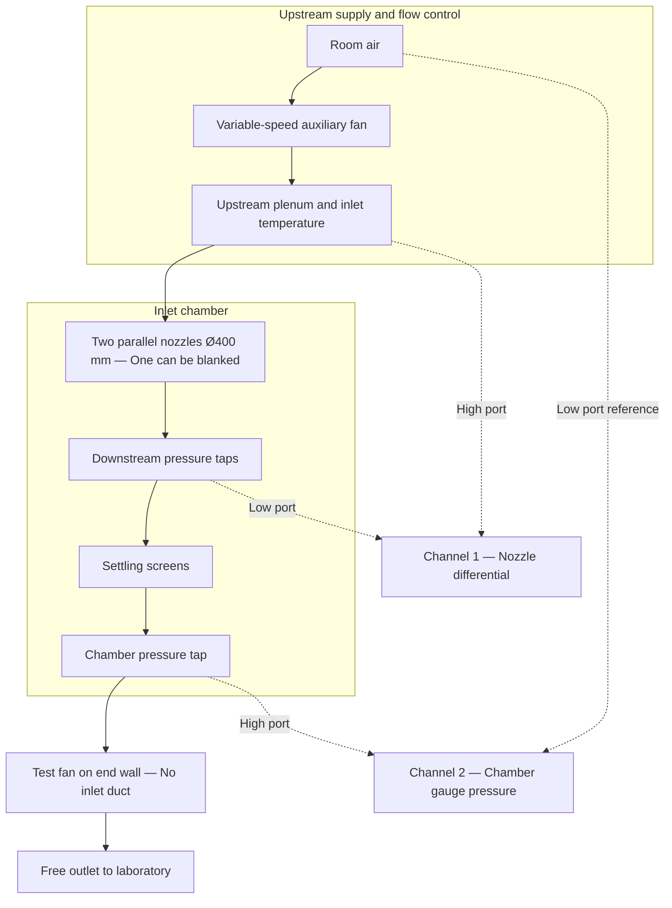

# Theoretical design of an axial fan for tunnel ventilation (SODECA THT/IMP-LS-UNI-50-2/4T-6-F400)

> **Project status — Release 1:** This document keeps the existing commercial reference and preliminary background, and develops the four Design requirements in `0_Preliminary/P1_preparing_course.md`: **(1) specifications and dimensionless parameters, (2) component geometry, (3) materials and justification, and (4) mean-line analysis**. Only **1445 rpm** is used for the theoretical aerodynamic design in this release. The commercial high-speed operating point is provided only for reference.
>
> **[TO VERIFY — MODEL IDENTIFICATION]** The previous document title stated `TJHT/2/4-500-C` (Soler & Palau), while its contents and calculations refer to `SODECA THT/IMP-LS-UNI-50-2/4T-6-F400`. Confirm the reference model against the actual QuickFan output and catalogue before submission.

## 1.- Dimensions

The reference machine is a unidirectional axial jet fan used for tunnel and car park ventilation. The nominal commercial impeller diameter is 500 mm. Theoretical design calculations use the **dimensions measured in the group's CAD assembly**, rather than replacing those dimensions with the nominal catalogue designation.

### 1.1.- Commercial assembly dimensions

The manufacturer provides the following overall dimensions for the THT/IMP-LS-50 model:


*Figure 1. Dimensional drawing of the commercial SODECA fan. Source: SODECA, THT/IMP technical catalogue, page 5. **[TO VERIFY]** Confirm the drawing and model variant match the selected commercial reference.*

| Dimension | Value (mm) |
|:--|--:|
| A | 546 |
| B | 549 |
| C | 742 |
| E — Overall length | 1445 |
| L — Casing length | 1200 |
| X | 560 |
| X1 | 255 |
| Z | 778 |
| Z1 | 808 |

### 1.2.- CAD rotor dimensions and design section

The following geometrical information was provided from CAD measurements:

| Parameter | Symbol | Value |
|:--|:--:|--:|
| Rotor outer diameter | $D_t$ | 494 mm |
| Hub outer diameter at the rotor | $D_h$ | 130.5 mm |
| Diameter stated for outlet section | $D_{out}$ | 514 mm |
| Number of rotor blades | $Z$ | 6 |
| Rotor tip radius | $r_t=D_t/2$ | 247.00 mm |
| Hub radius | $r_h=D_h/2$ | 65.25 mm |
| Blade radial span | $h=r_t-r_h$ | 181.75 mm |
| Arithmetic mean radius | $r_m=(r_t+r_h)/2$ | 156.125 mm |
| Root-mean-square radius | $r_{m,RMS}=\sqrt{(r_t^2+r_h^2)/2}$ | 180.65 mm |

**Assumption G1:** The rotor and hub are represented as concentric circular sections, and local flow blockage by blade thickness is neglected when calculating the preliminary annular passage area.

$$
A=\frac{\pi}{4}(D_t^2-D_h^2)
=\frac{\pi}{4}(0.494^2-0.1305^2)
=\boxed{0.178290\;\mathrm{m^2}}.
$$

The geometric circular area associated with the stated 514 mm outlet diameter is:

$$
A_{out,geom}=\frac{\pi}{4}(0.514)^2
=\boxed{0.20750\;\mathrm{m^2}}.
$$

**[TO VERIFY — OUTLET]** The 514 mm measurement has not yet been demonstrated to represent the **unobstructed effective outlet area**. The possible motor/hub blockage, grille and supporting structures must be evaluated before using this as an actual free-flow area.

**Assumption G2:** The *arithmetic* mean radius $r_m=0.156125$ m is used consistently in the Release 1 two-dimensional cascade and velocity triangles. The RMS radius is shown for reference only and is **not mixed** with the numerical results below. A radial design is planned for Release 2.

**[FIGURE REQUIRED — GROUP CAD]** Add a dimensioned front view and side/section view from CAD showing the casing, rotor, hub, inlet/outlet, motor and supports. Identify whether all shown items belong to the original commercial assembly or to the group's theoretical design.

## 2.- Performance and operating requirements

The commercial reference is the SODECA THT/IMP-LS-UNI-50-2/4T-6-F400, an axial jet fan that supplies momentum to the surrounding air to promote longitudinal ventilation.

The performance data previously entered in the project are:

| Parameter | High speed (commercial reference) | Low speed (Release 1 design point) |
|:--|--:|--:|
| Rotational speed (rpm) | 2915 | **1445** |
| Volumetric flow rate (m³/h) | 19700 | **9766** |
| Outlet air velocity (m/s) | 26.4 | **13.09** |
| Thrust (N) | 165 | **40.55** |

*Table 1. Previously recorded data attributed to SODECA QuickFan. **[TO VERIFY]** Confirm the exact fan variant and export the original QuickFan results, especially the reported thrust (40.55 N at low speed).*

**Assumption P1:** For consistency with the group's earlier dimensionless-parameter and blade-design calculations, the **rounded** low-speed inputs $Q=9770\;\mathrm{m^3/h}$ and $v_{jet}=13.1\;\mathrm{m/s}$ are used throughout the analytical model. The catalogue values of 9766 m³/h and 13.09 m/s remain documented above. **[TO VERIFY]** Recalculate all derived quantities together if the group decides to adopt the unrounded source values.

$$
Q=\frac{9770}{3600}=\boxed{2.713889\;\mathrm{m^3/s}},\qquad
N=1445\;\mathrm{rpm}.
$$

**Assumption P2:** The reference air properties are $\rho=1.20\;\mathrm{kg/m^3}$ and $\mu=1.81\times10^{-5}\;\mathrm{Pa\,s}$.

The dynamic pressure corresponding to the **nominal outlet jet velocity** is:

$$
p_{d,jet}=\frac12\rho v_{jet}^2
=\frac12(1.20)(13.1)^2
=\boxed{102.966\;\mathrm{Pa}}.
$$

**Important distinction:** $p_{d,jet}$ is the *jet dynamic pressure*, not a manufacturer-confirmed total-pressure rise. The real rotor pressure rise $\Delta p_{0,rotor}$ is **not provided** in the available project data.

**Assumption P3 (preliminary pressure model):** Only for the purpose of calculating an initial D1/D2 design point, **$\Delta p_{0,est}=p_{d,jet}=102.966\;\mathrm{Pa}$** is adopted as a provisional idealized rotor total-pressure rise. This equality may be inaccurate because of flow acceleration, swirl, inlet kinetic energy, losses and the exact measurement stations. All pressure-dependent results must therefore be identified as *estimated*.

As a consistency check, the geometric circular outlet area gives:

$$
\frac{Q}{A_{out,geom}}
=\frac{2.713889}{0.20750}
=13.079\;\mathrm{m/s}\approx13.1\;\mathrm{m/s}.
$$

This agreement supports the **geometric area used to report nominal jet velocity**, but does **not** prove that the 514 mm circle is the net free-flow area or validate $\Delta p_{0,est}$.

A generic fan characteristic diagram was included in the original project and is retained below as background:


*Figure 2. Generic fan characteristic curves; these are not measured curves of the selected SODECA fan.*

## 3.- Preliminary power estimate

The estimated jet power is:

$$
P_{jet}=Q\,p_{d,jet}
=2.713889(102.966)
=\boxed{279.44\;\mathrm{W}}.
$$

**Assumption P4:** The preliminary global jet-power-to-electrical-input efficiency is $\eta_{jet,overall}=0.50$, solely for an illustrative estimate; this is **not** a measured efficiency or a value confirmed by the manufacturer.

$$
P_{electrical,est}=\frac{P_{jet}}{\eta_{jet,overall}}
=\frac{279.44}{0.50}
=\boxed{558.88\;\mathrm{W}\approx0.56\;\mathrm{kW}}.
$$

**[TO VERIFY]** The earlier report stated a low-speed installed motor rating of 1.30 kW. Confirm this against the correct catalogue/variant. Motor **rated** power, absorbed **shaft** power and actual **electrical input** are distinct. The estimated 0.56 kW must not be presented as a verified measured consumption.

Because provisional $\Delta p_{0,est}=p_{d,jet}$, the idealized hydraulic power $Q\Delta p_{0,est}$ is numerically also 279.44 W. This numerical equality is a consequence of **Assumption P3**, not an independently measured hydraulic performance result.

**[DATA REQUIRED]** Measured or selected rotor total-pressure rise; shaft or electrical absorbed power; motor efficiency; actual global aerodynamic efficiency.

## 4.- Applications

According to the manufacturer, THT/IMP-type axial jet fans are intended to generate high-velocity jets for ventilation and, for appropriately certified variants, smoke-control applications in enclosed spaces such as car parks. This project uses the commercial SODECA fan as a reference for **tunnel longitudinal ventilation**, where the jet transfers momentum to the surrounding air and assists in pollutant dilution and air movement.

The model designation used in the project contains **F400**. **[TO VERIFY]** Confirm the precise fire-performance classification and relevant certificate for the reference product. Any commercial certification must **not** be transferred to the theoretical rotor designed by the group without separate validation.

Reference: [SODECA official website](https://www.sodeca.com). **[SOURCE REQUIRED]** Insert the precise catalogue and certification document URLs/pages used in the final report.

## 5.- Examples of other axial jet fans for tunnel ventilation

These products were selected by the group as commercial comparisons based principally on reported dynamic pressure. Their stated pressure values must not automatically be treated as rotor total-pressure rise.

| Manufacturer and model | Rotational speed (rpm) | Reported pressure (Pa) | Diameter | Airflow (m³/h) |
|:--|--:|--:|--:|--:|
| Soler & Palau — TJHT/2/4-500-C | 1440 | 94 | 500 mm | 8800 |
| Zitrón — JZp 4/H-1,5/0,37-2/4 RE F400 | 2845 | 220 | 400 mm | 8700 |
| Novovent — JET WINDER 4-560T-4 0.55 kW | 1500 | 78 | 490 mm | 10087 |

**[SOURCE / DEFINITION REQUIRED]** Add a technical datasheet link for each model and confirm whether the stated pressure refers to static, total, or jet dynamic pressure. Rotor blade counts for these reference models are not used as verified inputs unless supported by product documentation. The group has selected **six blades** for its own theoretical rotor.

## 6.- Dimensionless parameters and position in the Cordier diagram

This section follows the definitions presented in the D1 notebook and in Dixon and Hall (Chapter 2). The reference length is the **measured rotor diameter $D=D_t=0.494$ m** and the operating point is **1445 rpm only**.

$$
\omega=\frac{2\pi N}{60}
=\frac{2\pi(1445)}{60}
=\boxed{151.320\;\mathrm{rad/s}}.
$$

The mean axial speed through the rotor annulus is:

$$
c_x=\frac{Q}{A}
=\frac{2.713889}{0.178290}
=\boxed{15.222\;\mathrm{m/s}}.
$$

**Assumption F1:** Steady, incompressible flow with uniform mean axial velocity across the rotor annulus; the mean axial speed is assumed unchanged between rotor inlet and outlet ($c_{x1}=c_{x2}=c_x$). This is a one-dimensional simplification, not a measured profile.

### 6.1.- Flow coefficient

$$
\phi=\frac{Q}{\omega D^3}
=\frac{2.713889}{151.320(0.494)^3}
=\boxed{0.14877}.
$$

### 6.2.- Pressure coefficient

$$
\psi=\frac{\Delta p_{0,est}}{\rho\omega^2D^2}
=\frac{102.966}{1.20(151.320)^2(0.494)^2}
=\boxed{0.01536}.
$$

### 6.3.- Hydraulic power coefficient

$$
\hat P=\frac{Q\Delta p_{0,est}}{\rho\omega^3D^5}
=\phi\psi
=\boxed{0.002284}.
$$

### 6.4.- Reynolds number

The Reynolds number here is defined using the rotor diameter and the annular mean axial speed:

$$
Re_D=\frac{\rho c_xD}{\mu}
=\frac{1.20(15.222)(0.494)}{1.81\times10^{-5}}
=\boxed{4.99\times10^5}.
$$

The Reynolds number based on the **blade chord and inlet relative speed** is calculated separately in Section 9.

### 6.5.- Specific speed and specific diameter

$$
\Omega_s=\frac{\omega\sqrt Q}{(\Delta p_{0,est}/\rho)^{3/4}}
=\boxed{8.842},
$$

$$
D_s=\frac{D(\Delta p_{0,est}/\rho)^{1/4}}{\sqrt Q}
=\boxed{0.9127}.
$$

| Dimensionless parameter | Symbol | Calculated value at 1445 rpm |
|:--|:--:|--:|
| Flow coefficient | $\phi$ | 0.14877 |
| Pressure coefficient | $\psi$ | 0.01536 |
| Hydraulic power coefficient | $\hat P$ | 0.002284 |
| Diameter-based Reynolds number | $Re_D$ | $4.99\times10^5$ |
| Specific speed | $\Omega_s$ | 8.842 |
| Specific diameter | $D_s$ | 0.9127 |

### 6.6.- Position in the Cordier diagram

Figure 3 is the **group's existing Dixon-and-Hall-style Cordier diagram**, reproduced rather than replaced with a new schematic curve. The horizontal axis is the logarithmic specific diameter $D_s$ and the vertical axis is the logarithmic specific speed $\Omega_s$.

$$
\boxed{(D_s,\Omega_s)_{1445\,rpm}=(0.9127,\,8.842)}.
$$


*Figure 3. Cordier diagram used by the group, based on Dixon and Hall, Figure 2.8. The **orange low-speed marker** indicates the 1445 rpm condition in the characteristic axial-flow region. The source image also contains an older high-speed marker, which is not part of the present Release 1 design.*

**[FIGURE UPDATE REQUIRED — NUMERICAL CONSISTENCY]** The original screenshot labels the orange marker at $D_s\approx0.9237$, calculated with earlier diameter/reference data, and shows a **2915 rpm** marker. With the **current measured $D_t=494$ mm**, the correct Release 1 value is **$D_s=0.9127$**, $\Omega_s=8.842$. Before final submission, update the label/point on **this same Cordier diagram** and remove or clearly identify the high-speed marker as historical. Do not change the current numerical results to match the outdated plot.

**[IMAGE ACTION REQUIRED]** Upload the supplied `cordier_capture_release1.png` to the repository folder `images/`. If uploaded to a different path, update the relative image reference above.

## 7.- Geometry of the axial fan components

The commercial reference and preliminary theoretical fan have the following principal components. **The blade chord, profile and stagger are design choices, not CAD measurements of a finalized blade.**

| Component | Description / function | Current dimensions or known data | Information still required |
|:--|:--|:--|:--|
| Rotor blades | Six blades impart tangential momentum to the airflow | $Z=6$; $D_t=494$ mm; preliminary mean-radius chord selected in Section 9 | Exact NACA section, thickness, camber, twist, tip/root chords |
| Hub | Connects blade roots to rotating assembly | $D_h=130.5$ mm | Axial length, attachment and structural design |
| Shaft / rotor coupling | Transmits torque | **[DATA REQUIRED]** | Diameter, couplings, material and motor interface |
| Casing / duct | Contains flow and supports assembly | Existing commercial dimensions in Section 1 | Internal diameter at blade plane, local wall thickness, tip clearance |
| Motor | Drives the rotor | Low-speed operation at 1445 rpm | Nameplate, rated/absorbed power and motor geometry |
| Motor mounting supports | Secure motor inside the structure | Visible in CAD screenshots | Number, dimensions, obstruction and geometry details |
| Outlet | Delivers jet to surrounding air | Stated diameter 514 mm | True effective flow area and outlet obstruction |
| Protective grille, deflector and silencers | Safety/noise/jet management where applicable | Present in commercial product description | **[TO VERIFY]** Actual presence in the CAD configuration and dimensions |

**[FIGURE REQUIRED]** Insert at least one annotated CAD front view and one axial/section view. Record clearly the flow direction, hub, blade span, housing, motor and inlet/outlet sections.

**Assumption G3:** The 514 mm exit measurement is treated as a **geometric reference**, not automatically as the net open flow area. A claim of 'no obstruction' should be supported by the actual section used to calculate the flow area.

## 8.- Materials and characteristics. Justification

**[TO COMPLETE BY GROUP]** Material specifications and mechanical/thermal properties are not confirmed in the files supplied. These cells are intentionally blank; they must be completed using the final CAD bill of materials, product information or justified engineering selection.

| Component | Material / grade | Density | Strength / thermal properties | Selection / manufacturing justification |
|:--|:--|:--|:--|:--|
| Rotor blades |  |  |  |  |
| Hub |  |  |  |  |
| Shaft / coupling |  |  |  |  |
| Casing |  |  |  |  |
| Motor supports |  |  |  |  |
| Protective elements (if present) |  |  |  |  |

**[TO COMPLETE]** Specify environmental conditions, corrosion requirements, operating temperature, expected mechanical loads and manufacturing constraints. The original commercial fan's F400 designation does not establish compliance for the newly designed blade or assembly.

## 9.- Mean-line analysis and preliminary blade design

This Release 1 analysis follows the D2 notebook and applies the **arithmetic midspan radius** of Section 1. The flow model is steady and two-dimensional. The final airfoil selection and radial design belong to Release 2.

**Assumption F2:** The inlet has no pre-swirl: $c_{\theta1}=0$. This is a boundary-condition assumption; the absence of upstream guide vanes does not by itself prove that the real inflow has zero swirl.

**Assumption F3:** The provisional rotor pressure rise follows **Assumption P3** and the Euler energy-transfer equation is applied ideally, with no losses in the velocity-triangle calculation. This **does not imply a real overall fan efficiency of 100%**.

### 9.1.- Velocity triangles at the mean radius

$$
U_m=\omega r_m=151.320(0.156125)
=\boxed{23.625\;\mathrm{m/s}}.
$$

$$
c_{x1}=c_{x2}=c_x=15.222\;\mathrm{m/s},\qquad c_{\theta1}=0.
$$

For the idealized rotor:

$$
\Delta p_{0,est}=\rho U_m(c_{\theta2}-c_{\theta1}),
$$

$$
c_{\theta2}=\frac{102.966}{1.20(23.625)}
=\boxed{3.632\;\mathrm{m/s}}.
$$

The inlet and outlet relative speeds are:

$$
w_1=\sqrt{c_x^2+U_m^2}
=\boxed{28.104\;\mathrm{m/s}},
$$

$$
w_2=\sqrt{c_x^2+(U_m-c_{\theta2})^2}
=\boxed{25.128\;\mathrm{m/s}}.
$$

Using positive relative-flow angles measured from the axial direction toward the direction opposing blade motion:

$$
\beta_1=\arctan\left(\frac{U_m}{c_x}\right)
=\boxed{57.206^\circ},
$$

$$
\beta_2=\arctan\left(\frac{U_m-c_{\theta2}}{c_x}\right)
=\boxed{52.716^\circ}.
$$

$$
\beta_m=\arctan\left(\frac{\tan\beta_1+\tan\beta_2}{2}\right)
=\boxed{55.086^\circ}.
$$

| Velocity-triangle quantity | Inlet (1) | Outlet (2) |
|:--|--:|--:|
| Axial absolute velocity $c_x$ (m/s) | 15.222 | 15.222 |
| Absolute tangential velocity $c_\theta$ (m/s) | 0 | 3.632 |
| Relative velocity magnitude $w$ (m/s) | 28.104 | 25.128 |
| Relative flow angle $\beta$ (deg) | 57.206 | 52.716 |

**[FIGURE REQUIRED]** Insert inlet and outlet velocity triangles at $r_m$, specifying the axial/tangential sign convention and the vectors $\mathbf c$, $\mathbf w$ and $\mathbf U$.

### 9.2.- Blade count, pitch and diffusion criterion

The number of blades is fixed at the group-selected value $Z=6$. At the arithmetic mean radius:

$$
s=\frac{2\pi r_m}{Z}
=\frac{2\pi(0.156125)}{6}
=\boxed{0.163494\;\mathrm{m}=163.49\;\mathrm{mm}}.
$$

**Assumption B1:** For preliminary dimensioning, the allowable Lieblein diffusion factor is taken as $DF_{max}=0.45$. The D2 example also discusses values around 0.5. The selected design is checked against this conservative 0.45 limit.

$$
DF=1-\frac{w_2}{w_1}
+\frac{c_{\theta2}-c_{\theta1}}{2w_1}\frac{s}{l}.
$$

Setting $DF=DF_{max}$ and solving for the maximum pitch-to-chord ratio gives:

$$
\left(\frac{s}{l}\right)_{max}
=\frac{2w_1}{c_{\theta2}-c_{\theta1}}
\left(DF_{max}-1+\frac{w_2}{w_1}\right)
=\boxed{5.325}.
$$

$$
l_{min,DF}=\frac{s}{(s/l)_{max}}
=\frac{163.49}{5.325}
=\boxed{30.70\;\mathrm{mm}}.
$$

This lower bound prevents excessive diffusion in the simplified mean-radius model; it is **not** the final chord selection.

### 9.3.- Chord selection for the target lift coefficient

**Assumption B2:** A preliminary two-dimensional section drag coefficient $C_D=0.02$ is adopted, following the simplification in D2. Its validity for the actual airfoil at the operating Reynolds number remains to be established.

**Design requirement B3:** The group targets $C_L\approx0.75$ to remain below its preferred approximate upper range of 0.8–0.9. **$C_L=1$ is not the selected target.**

The mean-line cascade relation from Dixon and Hall, Equation (3.26a), is:

$$
C_L=2\frac{s}{l}\cos\beta_m
(\tan\beta_1-\tan\beta_2)
-C_D\tan\beta_m.
$$

The previously considered chord of $l=47$ mm would give:

$$
\left(\frac{s}{l}\right)_{47mm}
=\frac{163.494}{47}=3.479,
\qquad \boxed{C_{L,47mm}=0.921}.
$$

After correcting the hub and rotor diameters from CAD, **47 mm no longer meets the chosen target $C_L\approx0.75$** under the stated model.

Solving the lift equation for $C_{L,target}=0.75$:

$$
l=\frac{2s\cos\beta_m(\tan\beta_1-\tan\beta_2)}
{C_{L,target}+C_D\tan\beta_m}
=\boxed{57.35\;\mathrm{mm}}.
$$

A rounded **preliminary design chord $l=57.5$ mm** is adopted. This is a proposed dimension for subsequent CAD work, **not** a measured chord or a CFD-validated result.

$$
\frac{s}{l}=\frac{163.494}{57.5}=\boxed{2.843},
\qquad
\sigma=\frac{l}{s}=\boxed{0.352}.
$$

$$
\boxed{C_L=0.748},\qquad
\boxed{DF=0.290}.
$$

The corresponding blade-section Reynolds number based on the inlet relative velocity is:

$$
Re_l=\frac{\rho w_1l}{\mu}
=\frac{1.20(28.104)(0.0575)}{1.81\times10^{-5}}
=\boxed{1.07\times10^5}.
$$

| Quantity | Previous 47 mm chord | Proposed 57.5 mm chord |
|:--|--:|--:|
| Blade count $Z$ | 6 | 6 |
| Pitch $s$ (mm) | 163.49 | 163.49 |
| Chord $l$ (mm) | 47.00 | **57.50** |
| Pitch-to-chord $s/l$ | 3.479 | **2.843** |
| Solidity $l/s$ | 0.287 | **0.352** |
| Required $C_L$ | 0.921 | **0.748** |
| Diffusion factor $DF$ | 0.331 | **0.290** |

The rounded chord satisfies the selected mean-radius $C_L$ target and the diffusion-factor criterion within the adopted theoretical assumptions.

### 9.4.- Preliminary blade orientation and aerodynamic limitations

The calculated **flow angles** are $\beta_1=57.206^\circ$ and $\beta_2=52.716^\circ$. They are derived from the idealized velocity triangles and do **not** define a unique airfoil shape.

**Assumption B4:** The group has considered $\xi=53^\circ$ as a **preliminary chord stagger**, in analogy with the C3 cascade classroom example. The corresponding *chord-referenced* incoming angle is:

$$
\alpha_{chord}=\beta_1-\xi
=57.206^\circ-53^\circ
=\boxed{4.206^\circ}.
$$

This $\alpha_{chord}$ is not necessarily equal to the **metal-angle incidence** $i=\beta_1-\beta'_1$, which is measured relative to the inlet camber-line tangent. If the airfoil has camber, $\beta'_1$ generally differs from the chord stagger $\xi$.

**[TO COMPLETE — RELEASE 2]** Select and justify the actual airfoil; determine camber, thickness, inlet/outlet metal angles, spanwise chord and twist; calculate deviation consistently; and check actual lift, drag and exit flow with CFD. The 4.206° chord-referenced angle has **not** been shown to be the optimum CFD angle for the future selected rotor.

## 10.- Release 1 design summary and items requiring group input

| Deliverable or quantity | Status |
|:--|:--|
| Commercial reference and nominal dimensions | Retained; **exact variant to verify** |
| Rotor/hub CAD dimensions, six blades | Recorded |
| Selected operating condition | **1445 rpm** |
| Annular area and flow velocity | Calculated from measured diameters |
| Six dimensionless parameters and Cordier position | Calculated with **estimated** pressure rise |
| Mean-radius velocity triangles | Calculated with ideal Euler model |
| Minimum chord based on diffusion | 30.70 mm |
| Preliminary chord for $C_L\approx0.75$ | **57.5 mm**, giving $C_L\approx0.748$ |
| Mean-radius diffusion factor | **0.290** |
| Stagger | **53° provisional**; chord-referenced angle 4.206° |
| Final airfoil and full 3D blade geometry | **Pending Release 2** |
| Material grades / mechanical properties / manufacturing | **[TO COMPLETE]** |
| Rotor total-pressure rise | **[DATA REQUIRED]** |
| Actual motor/shaft/electrical power and efficiency | **[DATA REQUIRED]** |
| Updated Cordier plot using current diameter | **[FIGURE UPDATE REQUIRED]** |
| Labelled CAD views and velocity triangles | **[FIGURES REQUIRED]** |

## 11.- Computational fluid dynamics (CFD)

## 11.1 CAD description
## 11.2 Mesh description
## 11.3 Boundary conditions

## 12.- Experimentation: measurement of magnitudes and data acquisition (E1)

The selected test specimen is the complete commercial SODECA **THT/IMP-C-UNI-50-2/4T-6**, corresponding to the STEP model selected by the group. The proposed test will use the low-speed setting of **1,445 rpm**. The catalogue maximum airflow of **9,770 m³/h (2.714 m³/s)** is used as a reference to size the flow meter [9].
The actual airflow will be measured on the test bench.

The commercial fan is distinct from the theoretical rotor described in Design. The pressure and power estimates in Sections 2–3 are theoretical inputs. No experimental results are reported in this release.

The STEP cross-section shows an internal diameter of **514 mm** at bothends. The chamber will be connected to the motor-side inlet, as shown in Section 14.2. The mounting plate and fastening details remain to be defined.

| Quantity | Proposed measurement or calculation | Purpose |
|:--|:--|:--|
| Air volume flow rate, $Q$ (m³/s) | Calculate from the pressure difference across the calibrated nozzle bank, $\Delta p_n$, and air density. | Determine the operating point. |
| Fan static and total pressures, $p_{fs}$ and $p_f$ (Pa) | Measure chamber pressure relative to ambient on a second channel; derive the fan pressures using the configuration in Section 14 and confirmed outlet area. | Build the pressure–flow curves. |
| Rotational speed, $n$ (rpm) | Measure with an optical tachometer where there is a safe line of sight to a rotating target. | Check stability and document the test speed. |
| Air temperature $T$ (°C), barometric pressure $p_a$ (Pa) and relative humidity RH (%) | Measure at the inlet or a representative ambient location as appropriate for each variable. | Calculate air density $\rho$ and report test conditions. |
| Electrical active input power, $P_{\mathrm{el}}$ (W) | Measure at the test fan's motor supply with a three-phase power analyser; exclude the auxiliary fan's power. | Determine overall efficiency relative to the electrical input. |
| Shaft torque, $M$ (N·m), if accessible | Measure only if a suitable torque sensor can be coupled to the shaft without invalidating the test configuration. Then $P_{\mathrm{shaft}}=2\pi nM/60$. | Obtain shaft power and, if available, fan efficiency based on shaft power. |
| Air power and electrical-input efficiency | Calculate $P_{\mathrm{air}}\approx Qp_f$ and $\eta_{\mathrm{el}}=P_{\mathrm{air}}/P_{\mathrm{el}}$ at low pressure rise. | Compare performance at different flow rates. |

The design estimate of approximately 103 Pa comes from the jet velocity. It is separate from the nozzle differential pressure and cannot be treated as a measured fan pressure rise. Likewise, the installed motor rating of 1.30 kW is not the actual electrical input at a test point. A free-discharge jet thrust test, if required, would be a separate measurement under the approach described in ISO 13350 [9, 15].

### 12.1.- Flow measurement and preliminary nozzle sizing

The catalogue maximum airflow of **9,770 m³/h (2.714 m³/s)** is used as
the sizing reference for the flow meter [9].

| **Flow-measurement option** | **Fit to the proposed test** |
|:--|:--|
| ISA 1932 nozzle | Used in the course example. It remains an option for a duct-based bench if the pressure loss is acceptable. |
| Long-radius nozzle | Another option for a duct-based bench. Its throat diameter would need to be selected for the expected airflow and pressure differential. |
| Rounded-entry chamber nozzles | **Selected for the preliminary bench.** Two identical nozzles in parallel allow one to be closed at low airflow to increase the differential-pressure signal. The main drawback is the space required for the chamber. |

The choice follows the proposed chamber arrangement in Section 14.
If the chamber does not fit in the laboratory, the duct-based options
should be reconsidered [8, 16].

The flow meter uses the pressure difference across the nozzle bank,
$\Delta p_n$, to calculate airflow. For sizing, the same relation is
rearranged to estimate the pressure difference at a given airflow:

```math
A_n=N_{\mathrm{open}}\frac{\pi d_n^2}{4},
\qquad
Q\approx C_d A_n\sqrt{\frac{2\Delta p_n}{\rho}},
\qquad
\Delta p_n\approx\frac{\rho}{2}
\left(\frac{Q}{C_d A_n}\right)^2.
```

Here, $A_n$ is the total open throat area, $N_{\mathrm{open}}$ is the
number of open nozzles, $d_n$ is the throat diameter of each nozzle,
$C_d$ is the discharge coefficient and $\rho$ is the air density.
The preliminary calculation assumes $d_n=0.400\ \mathrm{m}$ and
$\rho=1.20\ \mathrm{kg/m^3}$. The coefficient $C_d=0.985$ is taken
from the course inlet-chamber example [8] as a sizing assumption.

**Worked example: two open nozzles at the catalogue reference airflow.**

```math
Q_{\mathrm{ref}}=\frac{9{,}770}{3{,}600}
=2.7139\ \mathrm{m^3/s},
\qquad
A_n=2\frac{\pi(0.400\ \mathrm{m})^2}{4}
=0.2513\ \mathrm{m^2}.
```

```math
\Delta p_n\approx
\frac{1.20}{2}\left(\frac{2.7139}{0.985\times0.2513}\right)^2
=72.1\ \mathrm{Pa}.
```

| **Reference airflow (m³/h)** | **Open nozzles** | **Estimated nozzle differential (Pa)** |
|--:|--:|--:|
| 9,770 | 2 | 72.1 |
| 4,885 | 2 | 18.0 |
| 4,885 | 1 | 72.1 |

With both nozzles open, halving the airflow reduces the estimated
differential to one quarter. At 4,885 m³/h, using only one nozzle
halves the open area and raises the estimated differential back to
72.1 Pa. Closing a nozzle changes the bench resistance, so the
operating point must be readjusted to compare both configurations at
the same airflow.

The proposed pressure sensor's basic accuracy limit of ±1.25 Pa
corresponds to a first-order effect on the calculated airflow of about
**±0.9% at 72.1 Pa** and **±3.5% at 18.0 Pa** [10]. This accounts
only for the pressure reading; the wider uncertainty assessment is
presented in Section 13.

### 12.2.- Selection of digital differential-pressure instruments

Two **WIKA A2G-500** differential-pressure transmitters with digital
display and Modbus RTU output are proposed. Both use the **±250 Pa
hardware version**, with different initial measurement settings [10].

| **Instrument** | **Measurement** | **Initial setting** |
|:--|:--|:--|
| WIKA A2G-500 — Channel 1 | Pressure difference across the nozzles, $\Delta p_n$. The high-pressure port is connected upstream and the low-pressure port downstream. | **0 to 250 Pa** |
| WIKA A2G-500 — Channel 2 | Chamber pressure relative to the laboratory, $p_{\mathrm{ch},g}$. The positive port is connected to the chamber and the negative port to ambient. | **−150 to +150 Pa**, to be checked during commissioning |

The first setting covers the **18–72 Pa** signals estimated in Section
12.1. The second channel is bidirectional because the chamber pressure
may be below ambient. WIKA specifies a basic accuracy of **±1.25 Pa
at 23 °C** for this hardware version [10].

Both readings will be recorded on a PC via **Modbus RTU over RS-485**.
The two channels will be zeroed before testing by exposing both ports of
each transmitter to the same pressure. Check that the selected ranges
cover the actual operating points before starting the test sweep.

### 12.3.- Air temperature measurement and data recording

Air temperature will be measured using a **TC Direct type T thermocouple,
ref. 405-388**, with a **Ø1.5 mm × 300 mm** sheath, connected to the
**TC Direct USB data logger, ref. 357-730** [11]. The probe tip will be
positioned in the inlet airflow, clear of the wall. Air temperature will
be used together with barometric pressure and relative humidity to
calculate air density.

The logger will be set to **type T, °C and one reading per second**.
The logger clock and the pressure acquisition PC clock will be aligned
before the test. For each operating point, the initial plan is to record
a **30 s window after the readings stabilise**. The temperature data
will then be downloaded via USB and matched to the pressure data using
timestamps and the operating-point ID.

> [!CAUTION]
> 🟥 **12-C · Instrumentation to verify.** Confirm availability of the
> proposed instruments or equivalent laboratory equipment. Obtain the
> thermocouple tolerance and logger accuracy, and check that the laboratory
> PC can download and export the recorded data.
> 
## 13.- Preliminary assessment of measurement uncertainty (E2)

### 13.1.- Input specifications

| Source | Available specification or preliminary treatment |
|:--|:--|
| WIKA pressure channels | Basic accuracy ±1.25 Pa for the ±250 Pa hardware range at 23 °C, per PE 88.05. Selecting a smaller display range does not improve the stated basic accuracy. Reassess zero drift, ambient-temperature effects, installation and repeatability [10]. |
| Nozzle area and $C_d$ | Obtain separate contributions from throat measurement, coefficient calibration and nozzle configuration. |
| Testo 465 | Basic specification ±(0.02% of reading + 1 digit), with 1 rpm resolution at 1,445 rpm: approximately ±1.29 rpm under the stated conditions [13]. |
| Testo 622 | Absolute pressure ±(3 hPa + 1 digit); RH ±(2 percentage points + 1 digit) at 25 °C and 10–90% RH [12]. |
| Type-T probe and logger | Obtain the combined accuracy from the two specifications or from a calibration of the complete temperature chain. |
| Hioki PW3337 | At 45–66 Hz the product page specifies basic active-power accuracy of ±(0.1% of reading + 0.05% of full scale) below 50% of full scale, and ±0.15% of reading at or above 50% of full scale. Apply the detailed manual for the chosen wiring, range and power factor; include external current transducers if used [14]. |

### 13.2.- Worked example at one assumed operating point

The course uncertainty task calls for a representative point, preferably near the BEP. A verified curve for the tested assembly is not available in this report, so the example uses a representative **assumed** flow below the catalogue maximum. Its value demonstrates the propagation method and does not locate the BEP.

Take $Q=2.40\ \mathrm{m^3/s}$ (8,640 m³/h), both nozzles open, $\Delta p_n=56.39\ \mathrm{Pa}$ calculated using Section 12.1, $p_{\mathrm{ch},g}=-25\ \mathrm{Pa}$, and $P_{\mathrm{el}}=600\ \mathrm{W}$. These figures illustrate the method; the point is not a measurement or an identified BEP. For this calculation only, use $A_2=\pi(0.514)^2/4=0.2075\ \mathrm{m^2}$ as a geometric proxy and $\rho=1.20\ \mathrm{kg/m^3}$. With the preliminary pressure model in Section 14, this gives $p_{fd}=80.27\ \mathrm{Pa}$, $p_f=105.27\ \mathrm{Pa}$ and $\eta_{\mathrm{el}}=0.4211$ (air power $P_{\mathrm{air}}=252.64\ \mathrm{W}$).

Treat the basic bounds of the two separate WIKA channels as independent rectangular input distributions, so $u(\Delta p_n)=u(p_{\mathrm{ch},g})=1.25/\sqrt{3}=0.722\ \mathrm{Pa}$. Use a **hypothetical** ±3 W bound for the electrical power chain to demonstrate the calculation; this is not an accuracy claim for the Hioki. Temperature, geometry and nozzle calibration are held fixed in this partial example. The flow and outlet dynamic pressure depend on the same $Q$, so their influence on efficiency is propagated through that common variable.

$$
u(Q)\approx \frac{Q}{2\Delta p_n}u(\Delta p_n),\qquad
u^2(p_f)\approx \left(\frac{2p_{fd}}{Q}u(Q)\right)^2+u^2(p_{\mathrm{ch},g}).
$$

$$
u^2(P_{\mathrm{air}})\approx
\left((p_f+2p_{fd})u(Q)\right)^2
+\left(Q\,u(p_{\mathrm{ch},g})\right)^2 .
$$

$$
u^2(\eta_{\mathrm{el}})\approx
\left(\frac{p_f+2p_{fd}}{P_{\mathrm{el}}}u(Q)\right)^2
+\left(\frac{Q}{P_{\mathrm{el}}}u(p_{\mathrm{ch},g})\right)^2
+\left(\frac{\eta_{\mathrm{el}}}{P_{\mathrm{el}}}u(P_{\mathrm{el}})\right)^2 .
$$

| Output | Partial standard uncertainty $u$ | Relative to assumed value |
|:--|--:|--:|
| Volume flow rate $Q$ | 0.0154 m³/s | 0.64% |
| Fan total pressure $p_f$ | 1.26 Pa | 1.19% |
| Electrical active power $P_{\mathrm{el}}$ | 1.73 W | 0.29% |
| Air power $P_{\mathrm{air}}$ | 4.43 W | 1.76% |
| Electrical-input efficiency $\eta_{\mathrm{el}}$ | 0.00749 (0.75 percentage points) | 1.78% |

> [!CAUTION]
> 🟥 **13-A · Data needed to replace the illustrative example.** Request a **traceable curve for the selected fan at 1,445 rpm**, with its mounting and efficiency definition, if the group has one. Otherwise identify a point from the eventual bench sweep. Keep the example as shown for Release 1. In the full budget, use the actual power analyser range and calibration, add repeatability, pressure-tap effects, nozzle diameter and coefficient, density and outlet-area contributions. Compare the appropriate uncertainty with the limits in the clauses referenced in Section 14. A maximum of electrical-input efficiency must not be reported as a shaft-efficiency BEP without shaft-power data.

## 14.- Preliminary test bench and application of UNE-EN ISO 5801 (E3)

### 14.1.- Mounting category and reference setups

A **Type 2 inlet-chamber concept for Category A** is proposed, following the course inlet-chamber example. The fan inlet faces the chamber with no test duct attached; its outlet discharges freely into the laboratory. The fan is mounted on the chamber end wall with a sealed interface outside the inlet passage. Any inlet duct added later would change the boundary condition and require the installation category to be reviewed. A similar layout can be found in **ANSI/AMCA 210-25, Figure 15**, an inlet chamber with multiple nozzles, settling screens and a variable supply system [8, 16].

This is an academic proposal for a pressure–flow characterisation. UNE-EN ISO 5801:2019 is the course reference for the standardized airways approach. ISO 5801 directs jet fan testing to ISO 13350; consequently, these chamber measurements would not certify the thrust or performance of the complete jet fan in free installation [15].

For the verification of the proposed rig, the course notebook on test benches points to Clauses 5–6 for mounting categories, Clauses 3 and 15 for fan pressures and power, Clause 12.5 and Annex A for flow measurement, and Clause 17 for uncertainty. It also points to Clause 12.9 and Annex H for humid-air properties. AMCA Figure 15 is a comparable bench example; it does not replace verification against the course's UNE-EN ISO reference [8, 15, 16].

### 14.2.- Sketch and preliminary dimensions



*Figure 14.1. Draft layout for Release 1. Solid arrows show airflow; dashed arrows show pressure lines or references. The sketch is not to scale and the dimensions below are proposed.*

For a side view, draw the chamber envelope around the nozzle plate and screens, put the test fan on the downstream end wall and leave the outlet open. In the view looking at the nozzle plate, draw the two throat centres at mid-height with a 1.24 m separation. Label the two nozzle taps, the chamber tap, the ambient reference and the inlet temperature probe; show the last two separately from the airflow path. The dimensions below are sufficient to redraw these two views without selecting a fan flange or inventing tap coordinates.

| Element | Preliminary dimension or choice | Basis |
|:--|:--|:--|
| Chamber internal width × height × axial length | 2.50 m × 1.40 m × 5.0 m, excluding auxiliary supply hardware and outlet clearance | Initial envelope to check against laboratory space and the selected reference layout. |
| Nozzle plate | Two 0.400 m throats at the same height and 1.24 m centre-to-centre | Centred in the chamber section: nearest side wall is 0.63 m from each centre; top and bottom are 0.70 m from the centres. |
| Nozzle exit to first settling screen downstream | 1.10 m preliminary axial spacing | AMCA Figure 15 gives a reference comparison of 2.5 throat diameters, or 1.00 m at Ø0.400 m. |
| Test-section duct lengths | Inlet 0 m; outlet 0 m | This proposal omits ducts connected to the fan's inlet or outlet so that the selected Category A arrangement is retained. |
| Fan interface | Nominal fan diameter Ø500 mm for layout only; actual chamber aperture and bolt pattern to be measured | The nominal rotor diameter is not a flange dimension. The Design section's Ø514 mm outlet is used only as a geometric proxy pending verification. |
| Nozzle centres for the plate view | $(x,y)=(0.63,0.70)$ and $(1.87,0.70)$ m, measured from the lower left inside corner | Geometric coordinates for the proposed plate only. |
| Pressure taps shown in the sketch | One station upstream of the nozzle bank, one downstream, and a separate chamber station after the screens | Indicate the relative positions in the draft. Assign numerical distances once the selected standard layout is checked. |

The chamber cross-section is $3.50\ \mathrm{m^2}$. Compared with a nominal 0.500 m circular inlet proxy ($0.196\ \mathrm{m^2}$), the area ratio is about 17.8; the course uses a ratio greater than 5 as an initial inlet-chamber check. At $Q=2.714\ \mathrm{m^3/s}$ the chamber's mean velocity is about 0.78 m/s, which supports the first approximation of chamber static pressure as inlet total pressure. The nozzle spacing and wall distances are also above the comparison values of §6.3.4 in AMCA 210-25 (3 and 1.5 throat diameters, respectively). These checks do not establish compliance with the complete ISO geometry [8, 16].

For the preliminary free-outlet model, $p_{fs}\approx -p_{\mathrm{ch},g}$ and $p_f\approx p_{fs}+p_{fd}$, where $p_{fd}=\rho(Q/A_2)^2/2$. This assumes the upstream total pressure is represented by the chamber pressure, the outlet static pressure is ambient and the selected area and density conventions are valid. Record the nozzle differential and the chamber gauge pressure separately. Verify the pressure stations and outlet area definition before using the model to process test data.

### 14.3.- Changing the operating point

Keep the test fan at its low-speed setting and vary the upstream auxiliary supply to obtain several steady flow points. Start with both nozzles open. Close one only for the lower-flow range if the pressure signal becomes too small, and repeat a point in the overlap to compare the configurations. The same nozzle bank measures flow in each case; the auxiliary supply sets the point. Record the actual speed and both pressure channels at every setting. Repeat one setting to assess repeatability.

Plot $p_{fs}(Q)$, $p_f(Q)$ and $\eta_{\mathrm{el}}(Q)$ after reducing the data. A comparison with CFD or Design requires matching the test geometry, speed, pressure definitions and measurement planes. The maximum flow achieved and the range of the pressure channels will depend on the rig and must be checked in commissioning.

> [!CAUTION]
> 🟥 **14-A · Confirm the bench envelope and mounting.** Obtain the **laboratory footprint and outlet clearance**, the **dimensioned inlet/outlet drawing** for the fan confirmed in 12-A and the **auxiliary fan curve**, if available. Check whether the 2.50 m × 1.40 m × 5.0 m chamber fits and whether the supply can overcome the estimated losses over the intended flow range. If it does not fit, compare the existing lab bench or a single-nozzle layout. The Release 1 sketch and tentative dimensions can remain as a proposal while these inputs are sought.

> [!CAUTION]
> 🟥 **14-B · Verify the standard layout before producing construction drawings.** Using the course copy of UNE-EN ISO 5801, confirm the Category A arrangement, the mounting interface, measurement planes, screen spacing and the definition of outlet area. Replace the indicative tap positions and Ø514 mm proxy with the checked values. Keep the preliminary calculation separate from any claim of compliance.

## 15.- References

1. UPC course repository: `0_Preliminary/P1_preparing_course.md` — *Quality criteria*, Design, Release 1.
2. UPC course repository: `1_Design/D1_fundamentals_and_dimensional_analysis.ipynb` — dimensional coefficients and Cordier analysis. **[TO VERIFY]** Confirm exact notebook filename if the repository has been updated.
3. UPC course repository: `1_Design/D2_mean_line_analysis_and_2d_cascade.ipynb` — velocity triangles, Lieblein diffusion factor, pitch/chord and lift coefficient.
4. UPC course repository: `2_CFD/C3_aerodynamics_of_2D_cascade.ipynb` — illustrative chord-angle/stagger setup; **not** a validated optimum for this rotor.
5. Dixon, S. L. and Hall, C. A., *Fluid Mechanics and Thermodynamics of Turbomachinery*, Chapters 2, 3 and 5.
6. SODECA THT/IMP technical catalogue and QuickFan selection tool. **[TO COMPLETE]** Exact catalogue document/edition, model variant, original output and page numbers.
7. Measurements of the group's CAD assembly: $D_t=494$ mm, $D_h=130.5$ mm, $D_{out}=514$ mm and $Z=6$. **[TO COMPLETE]** CAD filename and revision.
